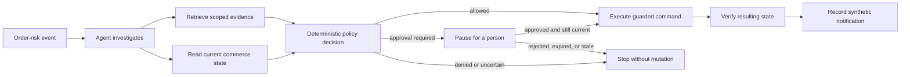

# Part 1: The idea in plain English

## The business problem

Imagine an online order is late or missing. A company may have to decide whether
to wait, refund the customer, create a replacement, submit a carrier claim, or
ask an employee to approve an exception.

That decision is harder than it first appears:

- the current order and inventory can change while the decision is being made;
- public regulations, carrier rules, seller policies, and internal policies may
  all apply;
- a general rule may have a narrower exception;
- important facts may be missing;
- two policies may conflict;
- some actions are safe to automate, while others require approval;
- retrying the same event must not create two refunds or replacements.

The demo asks a practical question:

> Can an AI agent help investigate the case while deterministic software remains
> responsible for authorization and mutation?

The implemented answer is yes, for the bounded synthetic scenarios in this
demo.

## Why an LLM alone is not enough

An LLM is useful for understanding a request, choosing relevant tools, and
assembling an investigation. It is not a safe source of truth for inventory,
policy eligibility, approval, or a business mutation.

For example, a model could:

- remember an old policy;
- retrieve a plausible but inapplicable section;
- overlook a policy exception;
- describe an action as allowed even though required facts are absent;
- continue using an approval after inventory or policy changed.

This demo therefore gives the LLM a limited role. It plans the investigation.
It does not get the final say.

## The control-tower pattern

The control tower separates adaptive work from authoritative work:

The important idea is not “let the AI operate the store.” It is:

> Let the AI coordinate an investigation inside boundaries that ordinary
> software can validate and enforce.

## Five responsibilities that stay separate

### 1. The skill explains the procedure

The skill says things such as: read order state first, search using the correct
scope, read decisive sections exactly, ask the deterministic evaluator, never
execute a denied result, and verify after execution.

It is intentionally compact. Large domain knowledge does not belong in the
skill.

### 2. The domain pack holds policy knowledge

The domain pack contains normalized policy sections, provenance, effective
dates, relations, search vocabulary, and golden retrieval cases. The commerce
pack represents material from public FTC, eCFR, USPS, FedEx, Target, and Walmart
sources together with an explicitly synthetic enterprise recovery policy.

The demo stores short excerpts and normalized facts with source URLs. It does
not claim that the pack is a complete or continuously updated legal corpus.

### 3. The agent coordinates

The agent receives an event, reads the current order, asks the knowledge gateway
for applicable evidence, and asks Commerce Core for a decision. The framework
records its plan and tool calls.

### 4. Deterministic code decides and mutates

Commerce Core checks facts, evidence receipts, release identity, order version,
decision age, approval proof, and idempotency. It returns outcomes such as
`allowed`, `approval_required`, `denied`, `insufficient_evidence`, or
`conflicting_evidence`.

Only Commerce Core can apply the synthetic order mutation.

### 5. Observability proves what happened

The task API reports the business result. Registry records the orchestration.
Jaeger records service-to-service calls. The final Commerce state proves whether
a mutation happened.

No single one of these views is enough by itself. Part 8 explains how to read
them together.

## What the demo proves

The demo proves that this separation can support:

- a normal order that never needs an agent or LLM;
- a bounded automatic recovery;
- a human-approved recovery;
- a deterministic denial;
- abstention when evidence is missing or conflicting;
- rejection of stale approval after policy or order state changes;
- duplicate-event and duplicate-command protection;
- reuse of the same knowledge gateway with a non-commerce domain pack.

## What it does not prove

This is a capability demo, not a production commerce design. It does not yet
provide durable commerce storage, authentication, automated policy ingestion,
provider embeddings, a 50-case evaluation, production security controls, or a
real external business side effect.

Those limitations are deliberate. They keep the local Kind deployment small
while preserving the important application boundaries.

Next: [Part 2: The parts we built](02-the-parts.md).
