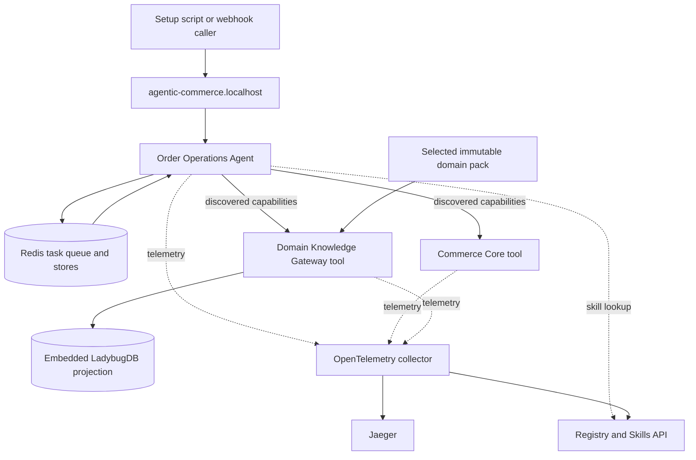
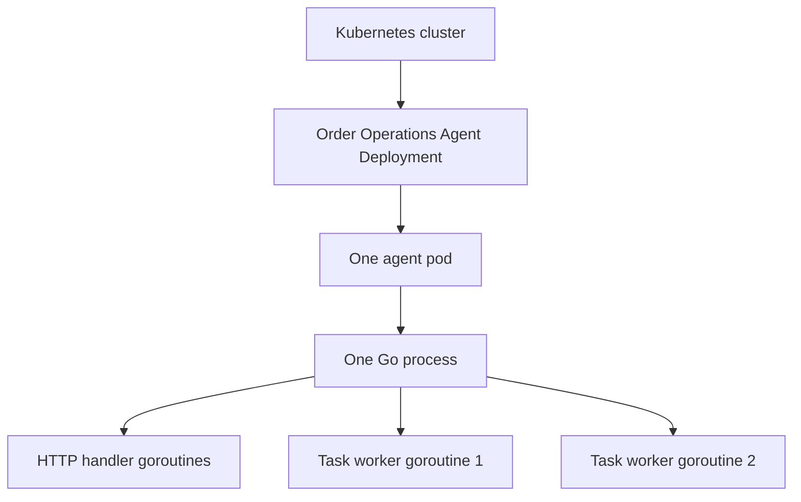

# Part 2: The parts we built

## The short version

The application adds three long-running workloads to the existing local Kind
cluster:

1. one Order Operations Agent;
2. one Commerce Core tool;
3. one Domain Knowledge Gateway tool.

It reuses the framework's Redis, Skills API, service registry, OpenTelemetry
collector, Registry Viewer, Jaeger, Loki, Prometheus, Grafana, and ingress.

LadybugDB is embedded inside the knowledge-gateway process. It is not a fourth
pod or a separate database service.

## Runtime picture



The dotted lines are observability or guidance. The solid lines are application
work.

## Pods, processes, and workers are different things

Kubernetes and the Go application provide different levels of concurrency. The
terms should not be used interchangeably:



| Level | What it means | Current agent setting |
|---|---|---:|
| Deployment | Kubernetes instructions for running and replacing pods | One Deployment |
| Pod replica | One running instance of the agent service | One pod |
| Go process | The compiled agent program running inside the pod | One process |
| HTTP goroutine | Lightweight concurrent handling of a webhook, status, or HITL HTTP request | Created as requests arrive |
| Task worker goroutine | Long-running consumer that takes one queued task at a time | Two workers |

A worker is not a Kubernetes pod and is not permanently tied to one operating
system thread. It is a lightweight Go goroutine. The Go runtime schedules many
goroutines across the OS threads and CPU cores available to the container. When
a worker is waiting for Redis, an LLM, or an HTTP tool response, Go can park it
without dedicating a CPU core to that wait.

The current agent starts its worker pool like this:

```text
1 agent pod
└── 1 Go process
    ├── HTTP server goroutines
    ├── task worker-1
    └── task worker-2
```

`WORKER_COUNT=2` means the pod can process at most two top-level order tasks at
one time. It does not mean the pod can accept only two webhook requests. The
HTTP server can validate and enqueue many events while the two workers remain
busy.

For example, if 100 valid events arrive together and neither active task has
finished yet:

```text
100 webhook requests accepted
        |
        +--> 2 tasks actively processed by worker goroutines
        |
        +--> 98 tasks waiting in Redis
```

The approximate top-level task concurrency is:

```text
agent pod replicas × workers per pod
```

| Agent pods | Workers in each pod | Maximum active top-level tasks |
|---:|---:|---:|
| 1 | 2 | 2 |
| 1 | 10 | 10 |
| 3 | 10 | 30 |

This is only the top-level task count. One task can contain independent plan
steps that the orchestrator executes concurrently, so the number of active LLM
or tool operations can be higher than the number of workers.

### How this differs from Travel Chat Agent

Travel Chat Agent does not put ordinary chat requests into a task queue. Each
connected `/chat/stream` request runs directly in an HTTP-handler goroutine and
streams its result back to the caller.

| Travel Chat Agent | Order Operations Agent |
|---|---|
| HTTP handler performs the orchestration | HTTP handler validates and enqueues a task |
| Client connection stays open for SSE | Caller receives HTTP 202 and polls status |
| No application task-worker pool for normal chat | Fixed task-worker pool consumes Redis tasks |
| Concurrent HTTP handlers determine active chats | Worker count determines active top-level order tasks |
| No application queue for an ordinary chat request | Redis-backed tasks survive independently of the submission connection |

Both services use Go goroutines. The difference is whether work remains tied to
the HTTP connection or is handed to a shared application queue.

### What can and cannot be scaled today

Increasing the agent's worker count gives one pod more concurrent task slots.
Adding agent replicas could multiply those slots because tasks, deduplication,
and checkpoints use shared Redis.

The complete demo cannot yet be horizontally scaled safely, however, because
Commerce Core keeps orders, decisions, commands, and notifications in the
memory of its one pod. Two Commerce Core replicas would have two different
copies of business state. Production horizontal scaling therefore requires a
shared transactional store and database-enforced order-version and idempotency
constraints.

The current `one agent pod × two workers` setting is a conservative laptop-demo
choice. It is not an architectural limit or a production throughput claim.

## 1. Order Operations Agent

The agent has two jobs:

- accept a validated order-risk webhook and put a task in Redis;
- consume the task and orchestrate the investigation.

The webhook responds with HTTP 202 because the work happens asynchronously. It
returns a stable task ID and a `status_url`. The event ID is retained for 24
hours to reject duplicate active or completed deliveries.

The agent is bound to the
`order-operations/evidence-grounded-recovery` skill. It also has two application
guards around the framework:

- a plan hook binds security-relevant fields such as order ID, decision time,
  evidence channel, and graph bounds to trusted or observed values;
- a response hook replaces model narration with an outcome derived from actual
  tool results.

This means the model can propose a plan, but it cannot silently change the
order identity, broaden graph traversal, or relabel a deterministic denial as a
success.

## 2. Commerce Core tool

Commerce Core owns synthetic business truth:

- eight orders and their versions;
- inventory and fulfillment state;
- bounded recovery options;
- deterministic policy evaluation;
- decision tokens;
- idempotent commands;
- post-command verification;
- synthetic notification records.

### The simplest way to understand Commerce Core

Commerce Core is not another AI system. It is ordinary deterministic software
written in Go. Think of it as three small business-system roles combined:

1. **Rules calculator:** compares current order facts with explicit eligibility
   rules and approval thresholds.
2. **Safety gate:** checks the policy release, signed evidence receipts, order
   version, expiry, approval proof, and duplicate-protection key.
3. **Transaction owner:** is the only demo component allowed to change an order,
   and verifies what changed.

It accepts structured JSON. It does not understand a customer sentence, search
policy prose, call an AI provider, or invent a rule.

### AI Agent versus Commerce Core

| Order Operations Agent | Commerce Core |
|---|---|
| Uses a language model. | Does not use a language model. |
| Understands a flexible request. | Accepts only defined JSON fields. |
| Plans an investigation. | Executes a fixed decision procedure. |
| Chooses search wording and evidence candidates. | Checks required stable section IDs and signed receipts. |
| May adjust its plan when context changes. | Returns the same result for the same valid inputs, current state, and rules. |
| Can propose an option. | Authorizes only predefined options. |
| Cannot change the order directly. | Owns the controlled synthetic mutation. |

The agent answers an open question: “How should I investigate this case?”
Commerce Core answers a closed question: “Given this exact order, option,
release, and evidence, which governed outcome applies?”

### How `evaluate_recovery_policy` works

The agent supplies:

- an order ID;
- one predefined option ID;
- the pinned release ID and hash;
- the shared decision time;
- exact evidence section IDs;
- one signed exact-read receipt for every section.

Commerce Core then performs these steps:

```text
1. Load the current order from its own store
2. Confirm that the supplied release is still active
3. Confirm that every section belongs to that release
4. Validate every receipt's signature, lifetime, scope, section, and time
5. Run the selected option's fixed Go eligibility rule
6. Apply the configured refund or replacement approval threshold
7. Return one outcome and store a 15-minute decision basis
```

The agent does **not** send a complete order snapshot for Commerce Core to
trust. It sends the order ID, and Commerce Core reads current order truth
itself.

The five outcomes have distinct meanings:

| Outcome | Deterministic reason |
|---|---|
| `insufficient_evidence` | A decisive section, required receipt, or carrier fact explicitly treated as evidence is missing. |
| `conflicting_evidence` | Two equally applicable sections disagree and no reviewed precedence resolves them. |
| `denied` | Evidence is available, but current order facts fail the option's rule. |
| `approval_required` | The option is eligible, but a configured threshold requires a person. |
| `allowed` | The option is eligible, evidence is sufficient, and no approval threshold is crossed. |

Evaluation stores a short-lived decision record, but it does not change the
order. A separate call to `execute_recovery_command` must pass all guards before
mutation.

### The important policy limitation

The Knowledge Gateway returns exact text so the agent and operators can
understand and audit the policy. It also returns a signed receipt proving that a
specific section was read in the correct scope.

Commerce Core does not translate that paragraph into executable logic. Its Go
decision table refers to known, stable section IDs. For example, the
same-SKU-replacement rule checks for replacement-authority evidence and then
checks inventory, fraud risk, restrictions, and value.

Therefore, adding a new document to a domain pack can improve what the agent can
find, but it does not automatically teach Commerce Core a new business rule. A
new authoritative rule needs a reviewed change to the structured release data
and, when its logic is new, the deterministic evaluator.

This separation is intentional: policy retrieval can be adaptive, but business
authorization remains reviewable and repeatable.

### Worked example: ORD-1003

For the automatic replacement scenario, Commerce Core reads:

```text
fulfillment_status = missing_in_transit
inventory_available = true
fraud_risk = low
restricted = false
item_value_usd = 69
replacement_approval_over_usd = 75
```

The replacement-authority section has a valid receipt. The facts pass the
replacement rule, and 69 USD does not cross the 75 USD approval threshold. The
result is `allowed`.

For an otherwise eligible 249 USD replacement, the result is
`approval_required` when approval-threshold evidence is present. If that
threshold evidence is missing, the result is `insufficient_evidence`.

### How close this is to a real commerce system

The control pattern is realistic, but the demo combines responsibilities that a
large company may split across its order-management, inventory, fraud, policy,
payment, approval, notification, and audit systems. The demo also uses synthetic
orders, an in-memory store, and a small Go decision table. This makes the real
authority boundary visible without requiring production infrastructure.

The control pattern can be reused in another domain. This implementation cannot:
its option rules and order mutations are commerce-specific. Another domain needs
its own deterministic authority module behind the same agent-to-tool boundary.

It exposes six capabilities to the agent:

| Capability | Plain-English purpose |
|---|---|
| `get_order_context` | Read the current order and facts. |
| `list_fulfillment_options` | Return the bounded actions that may be considered. |
| `evaluate_recovery_policy` | Return the authoritative decision from validated facts and evidence. |
| `execute_recovery_command` | Revalidate and apply one idempotent synthetic mutation. |
| `verify_order_outcome` | Check the expected state after execution. |
| `send_synthetic_notification` | Record a local notification after verification. |

Two additional development-only controls are hidden from agent discovery:

- `process_normal_order`, used to prove the no-agent/no-LLM path;
- `manage_demo_state`, used by paired tests to reset or deliberately change
  synthetic state.

The hidden controls are test fixtures, not powers available to the LLM.

## 3. Domain Knowledge Gateway tool

The gateway is a controlled policy library and retrieval service. It has four
roles:

1. **Release keeper:** identifies the exact immutable policy snapshot in use.
2. **Scoped retriever:** filters and ranks policy sections without putting the
   entire corpus into the agent prompt.
3. **Graph navigator:** follows authored links such as `REQUIRES`, `OVERRIDES`,
   and `CONFLICTS_WITH`.
4. **Evidence notary:** returns an exact section with a short-lived signed
   receipt that Commerce Core can verify.

It does not decide whether a business action is allowed, change an order, or
call an LLM.

### Where the knowledge comes from

The gateway does not crawl websites while it handles a request. The demo starts
with a prebuilt, versioned `pack.json`:

```text
Public documents + synthetic internal policy
                  |
                  v
Human-curated offline normalization
                  |
                  v
Sources + sections + scope + dates + aliases + relations + tests
                  |
                  v
Immutable pack.json
```

The commerce pack records seven sources and eighteen normalized sections. Each
source includes a title, publisher, URL, retrieval time, extraction method, and
licence note. Each section has a stable ID, normalized content, source ID,
jurisdiction, channel, effective dates, priority, tags, and optional structured
facts.

The pack also contains:

- reviewed vocabulary aliases, such as `reship -> replacement`;
- explicit graph links between known sections;
- golden retrieval cases with expected and forbidden section IDs;
- a release identity and SHA-256 content hash.

At startup, the gateway strictly validates the pack. It rejects unknown fields,
missing source references, duplicate IDs, invalid dates, broken relations, and
invalid golden cases. It then canonicalizes the pack and verifies or computes
its content hash.

The URLs remain provenance links. The running demo does not download them,
perform OCR, chunk new documents, or ask an LLM to prepare new sections.

### What is built at startup

The canonical `pack.json` is the source of truth. The gateway creates two local
views from it:

```text
pack.json
   |
   +--> in-memory reference view
   |      - source and section records
   |      - hard filtering
   |      - lexical ranking
   |      - alias-vector ranking
   |
   +--> embedded LadybugDB projection
          - Section nodes
          - typed LINK relationships
          - graph existence and traversal checks
```

LadybugDB is not a separate service or pod. It is an embedded library and file
inside the gateway pod. The projection is disposable and can be rebuilt from
the pack.

This implementation detail matters: LadybugDB does **not** currently run the
BM25-style or alias-vector search. The in-memory reference store performs that
ranking. LadybugDB stores the graph projection, confirms exact section nodes,
and confirms relationship paths.

### How `search_evidence` works

The request contains:

- a natural-language evidence need;
- tenant ID;
- jurisdiction;
- activity channel;
- decision time;
- optional release ID, tags, and result limit.

Retrieval then follows a fixed pipeline:

```text
1. Validate required query and scope
2. Select the active or requested immutable release
3. Remove sections outside tenant, jurisdiction, channel, or effective date
4. Apply optional controlled tags as an OR filter
5. Rank the remaining sections in two independent lanes
6. Fuse the two rankings with reciprocal-rank fusion
7. Prefer an explicitly named source over unrelated peer sources
8. Return the top results and one-hop relation paths
```

The default final limit is eight candidates, and the public API permits at most
twenty.

#### Ranking lane A: BM25-style lexical relevance

The gateway tokenizes each section's title, content, and tags. It lowercases
words, removes a small stop-word list, and applies a small stemmer. A BM25-style
formula rewards matching terms according to their frequency and rarity. The
section's reviewed priority can boost its score.

This lane is good at direct wording such as “replacement,” “refund,” or
“Priority Mail Express.”

#### Ranking lane B: deterministic alias-aware similarity

This is called `VectorSearch` in the private store interface, but it does not use
an embedding model or a production vector database.

The gateway:

1. normalizes words through the pack's reviewed aliases;
2. hashes words and neighbouring word pairs into 128 numeric buckets;
3. builds one vector for the query and one for each section;
4. compares them using cosine similarity.

This lets reviewed terms such as “reship” and “replacement” meet. It is
repeatable and works offline, but it does not understand every unseen synonym
or policy meaning. An alias missing from the pack can lead to a missed result.

#### Combining the two lists

Reciprocal-rank fusion combines positions rather than treating the two raw
scores as directly comparable. A section can rise because it ranks well in
either lane or appears in both.

If the query explicitly names one publisher or source, the gateway removes
unmatched peer sources of the same type. For example, a carrier-specific query
does not keep another carrier merely because both share shipping words. Other
authority layers, such as applicable government policy, can remain.

### Search candidate versus exact evidence

In this demo, each search candidate includes its normalized section content,
stable ID, source metadata, score, retrieval method, and matched terms. It still
is not an authorization record.

```text
search_evidence
    -> “This section looks relevant; inspect it.”

read_exact_section
    -> “This exact section was read in this release and scope.”
```

`read_exact_section` repeats the release, tenant, jurisdiction, channel, and
effective-date checks. It then returns the exact section and source plus a
30-minute evidence receipt.

The receipt contains:

- section ID;
- release ID and release hash;
- tenant, jurisdiction, and channel;
- decision time;
- issue and expiry times;
- receipt version and HMAC signature.

The payload is encoded but not encrypted. The signature is tamper-evident:
changing any protected field makes Commerce Core's verification fail. The
receipt proves the read; it does not claim that the policy permits an action.

### How graph traversal works

Relations are authored in the domain pack. The gateway does not ask an LLM to
invent graph edges. The commerce pack uses links such as:

```text
demo-auto-recovery-bounds
    --REQUIRES--> demo-evidence-precedence
    --ESCALATES_TO--> demo-approval-thresholds
    --FOLLOWED_BY--> demo-verification-notification
```

`search_evidence` automatically returns up to twenty one-hop paths from its
ranked candidates. The separate `traverse_relations` capability can accept
starting section IDs and an optional relation-type allow-list. The gateway API
supports depths one through three, while this agent's application guard fixes
its planned traversal to one hop and twenty paths for the demo.

Graph traversal finds connected policy sections. It does not decide which rule
wins or whether a business action is authorized.

### Worked example: ORD-1003

For the replacement investigation, the agent asks for replacement authority,
limits, approval, and precedence in the `commerce-demo`, US, online scope at the
shared decision time.

The gateway filters the pack, runs both rankings, fuses them, and returns
candidate sections plus one-hop relations. The agent selects and exactly reads:

- `demo-auto-recovery-bounds`;
- `demo-approval-thresholds`;
- `demo-evidence-precedence`.

The gateway creates one signed receipt for each exact read. The agent sends
those IDs and receipts to Commerce Core. The gateway never returns `allowed`;
Commerce Core produces that outcome.

### Domain portability and storage replacement

The gateway's public contract and private `KnowledgeStore` interface are
domain-neutral. A different domain supplies different sources, sections,
aliases, tags, relations, and golden cases.

Agent code never sends a Ladybug query and never imports LadybugDB. A future
Neo4j, OpenSearch, or managed retrieval adapter can implement the same private
interface without changing the four public capabilities. The current in-memory
ranking and embedded graph projection are a laptop-demo implementation, not a
production corpus-size claim.

The gateway exposes four read-only capabilities:

| Capability | Plain-English purpose |
|---|---|
| `get_release_info` | Identify the active immutable domain release and hash. |
| `search_evidence` | Find relevant sections after hard scope and date filtering. |
| `traverse_relations` | Follow bounded links such as an exception, prerequisite, or procedure. |
| `read_exact_section` | Return one cited section and a signed scoped receipt. |

One hidden gateway control can activate an allow-listed demo pack. It is used to
prove live switching to the IT-access pack without rebuilding or restarting the
gateway.

## Public capabilities versus internal controls

The agent discovers exactly ten public capabilities: six from Commerce Core and
four from the gateway. Internal demo controls remain callable only through
explicit development paths.

This distinction matters. A test needs a way to simulate “inventory changed
while approval was pending,” but the model must not be able to manufacture that
state change itself.

## The normal-order fast path

A healthy order does not need reasoning. The setup driver calls the hidden
`process_normal_order` control directly and verifies existing invariants:

```text
confirmed + paid + inventory reserved
    -> normal_order_confirmed
    -> agent_invoked=false
    -> llm_invoked=false
```

Only an order-risk event enters the agent workflow. This prevents the demo from
pretending every ordinary transaction needs AI.

## Why this is only three application pods

- Redis and telemetry already belong to shared TruvaG3 infrastructure.
- The event simulator is a setup-host command, not another service.
- LadybugDB is a library and local projection inside the gateway pod.
- The synthetic policy evaluator belongs with the service that owns the
  mutation boundary.

The result is intentionally small enough for a laptop while still showing real
service discovery, asynchronous tasks, tool calls, HITL, and distributed traces.

## Code map

| Question | Start here |
|---|---|
| How is everything deployed? | [`k8-deployment.yaml`](../../k8-deployment.yaml) |
| Which commands can I run? | [`setup.sh`](../../setup.sh) |
| How does webhook deduplication work? | [`order-operations-agent/webhook.go`](../../order-operations-agent/webhook.go) |
| How is a task orchestrated? | [`order-operations-agent/event_processor.go`](../../order-operations-agent/event_processor.go) |
| What procedure is injected? | [`evidence-grounded-recovery.json`](../../order-operations-agent/skills/packages/order-operations/evidence-grounded-recovery.json) |
| What are the ten public capabilities? | [`tool-capabilities.md`](../../contracts/tool-capabilities.md) |
| Where is deterministic commerce logic? | [`commerce-core/store.go`](../../commerce-core/store.go) |
| Where is retrieval implemented? | [`domain-knowledge-gateway/internal/knowledge/`](../../domain-knowledge-gateway/internal/knowledge/) |

Next: [Part 3: From evidence to safe action](03-evidence-to-action.md).
