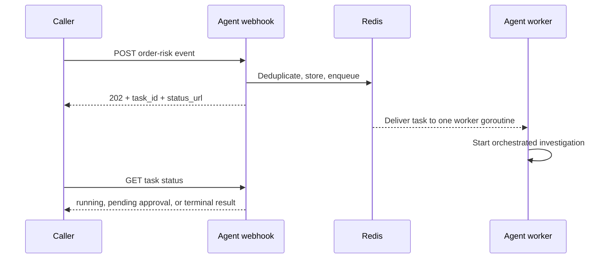
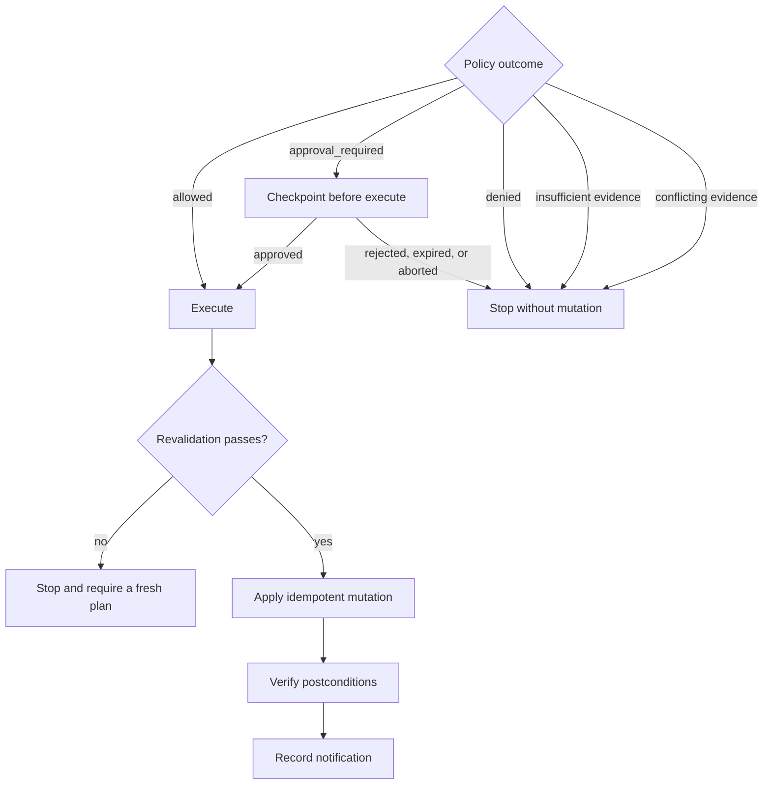

# Part 3: From evidence to safe action

This chapter follows the logic of one risky order without focusing on a
particular execution ID. Part 4 applies the same flow to a captured live run.

## Step 1: Accept a bounded event

The webhook accepts a small JSON event containing an event ID, order ID, signal,
optional requested outcome, optional bounded option ID, and decision time.

The event text is treated as untrusted data. It does not become a system prompt.
The agent binds the order identity and any operator-constrained option into
trusted request metadata.

## Step 2: Create an asynchronous task

The webhook creates `order-event-<event_id>` in the Redis task store, enqueues
it, and immediately returns HTTP 202 with a task status URL.

This separates submission from processing:



The worker is a goroutine inside the long-running agent pod. The current pod
has two such workers, so it can actively run two top-level order investigations
while further accepted events wait in Redis. The webhook and task-status HTTP
handlers use separate goroutines and remain responsive while workers are busy.

This queue is deliberate backpressure: an arrival spike does not immediately
turn every event into an unbounded set of LLM calls. Increasing worker count or
agent replicas increases consumption concurrency, subject to provider limits
and the shared-state constraint described in
[Part 2](02-the-parts.md#what-can-and-cannot-be-scaled-today).

## Step 3: Load the skill

The framework resolves the required
`order-operations/evidence-grounded-recovery` skill from the Skills store. The
skill is the workflow playbook. It tells the planner to:

- read state and options first;
- use the correct tenant, jurisdiction, channel, release, and decision time;
- read decisive evidence exactly;
- follow relevant relations;
- accept the deterministic evaluator's outcome;
- execute only an allowed or approved result;
- verify before reporting completion.

The skill does not contain all FTC, merchant, or carrier policies. Those stay in
the domain pack and are fetched only when relevant.

## Step 4: Read current business state

The agent calls `get_order_context` and `list_fulfillment_options`.

These calls establish facts the model cannot invent, such as:

- current order version;
- payment and fulfillment status;
- merchandise value and restriction flags;
- inventory availability;
- carrier facts;
- which recovery option IDs are currently available;
- which evidence channel governs each option.

If an operator supplied a requested option, the agent must evaluate only that
option. It cannot silently choose a different action after a denial.

## Step 5: Search the right policy scope

The agent sends a natural-language evidence question, not the entire order or
entire policy corpus. It also sends the trusted scope derived from the order and
task.

The gateway first applies hard filters:

```text
tenant + release + jurisdiction + channel + effective date
```

Only the remaining sections are ranked. Ranking combines:

- BM25-style lexical relevance for exact words and phrases;
- a deterministic semantic feature vector using aliases owned by the pack;
- reciprocal-rank fusion to combine the two ranked lists.

The lexical lane uses tokenization, a small stemmer, term rarity, and section
priority. The second lane uses reviewed aliases from the pack, hashes words and
word pairs into a 128-value vector, and applies cosine similarity. It does not
call an embedding provider or a learned reranker.

This is not a substring search and it is not unrestricted learned vector
similarity. It is a deterministic hybrid search designed for a repeatable local
demo. Hard applicability filters run before relevance ranking.

The gateway returns ranked candidate objects containing section content and
IDs, source metadata, matched terms, scores, retrieval methods, release
identity, and one-hop relationship paths. Search results are candidates, not
yet the authorization basis.

## Step 6: Follow policy relationships

Some decisions depend on a relationship rather than one paragraph. For example:

- a general rule may have an exception;
- one source may override another;
- two rules may explicitly conflict;
- a rule may require a separate procedure or fact.

The agent can call `traverse_relations`, but the application plan hook fixes the
demo to a one-hop, twenty-path bound. This keeps graph exploration useful and
inspectable.

The links were written into the domain pack before runtime. LadybugDB stores a
disposable graph projection of those section nodes and links inside the gateway
pod. It does not invent relationships or run the demo's relevance ranking.

## Step 7: Read decisive sections exactly

The agent calls `read_exact_section` for the sections it intends to use. Each
successful read returns:

- the exact normalized section;
- its source URL and metadata;
- the immutable release ID and content hash;
- a short-lived evidence receipt signed by the gateway.

The receipt is bound to the section, release, tenant, jurisdiction, channel,
and decision time. A section ID copied from another scope is therefore not
enough.

The receipt also carries issue and expiry times and an HMAC signature. It is
signed, not encrypted: callers may read the claims, but changing them makes the
signature invalid. The receipt proves an exact read; it does not authorize an
action.

## Step 8: Ask deterministic policy

The agent sends paired section IDs and receipts, the release identity, the
order ID, option ID, and shared decision time to
`evaluate_recovery_policy`.

Commerce Core does not trust an order snapshot supplied by the model. It reads
the current order from its own store, validates the release and receipts, and
then runs the selected option's fixed Go rule.

```text
Agent assembles the case
        |
        | order ID + option + pinned release
        | exact section IDs + signed receipts + decision time
        v
Commerce Core reads current order truth
        |
        v
Commerce Core validates evidence proof and scope
        |
        v
Commerce Core runs a fixed option-specific decision table
        |
        v
One authoritative outcome
```

The policy text helps the agent and operator understand the case. Commerce Core
does not ask an LLM to interpret that text. Its reviewed decision table checks
known section IDs, current order facts, dates, and configured thresholds.

Commerce Core returns one authoritative outcome:

| Outcome | Meaning |
|---|---|
| `allowed` | The bounded action may execute automatically. |
| `approval_required` | The action is eligible but must pause before execution. |
| `denied` | A deterministic rule prohibits the requested option. |
| `insufficient_evidence` | Required facts or evidence are absent. |
| `conflicting_evidence` | Applicable evidence conflicts and precedence cannot resolve it. |

For an eligible action, the response also contains a short-lived decision token
bound to the order version, option, and evidence basis.

The LLM cannot create a valid token.

For example, the ORD-1003 same-SKU replacement is `allowed` because replacement
authority has a valid receipt, inventory is available, fraud risk is low, the
item is not restricted, and its 69 USD value is below the 75 USD replacement
approval threshold. The conclusion comes from fixed code and current state, not
from model confidence.

## Step 9: Execute or stop

The application turns the deterministic outcome into a fixed branch:



Immediately before mutation, Commerce Core checks:

- active policy release and hash;
- approval proof for approval-class decisions;
- current order version;
- decision expiry;
- evidence receipts and scope;
- idempotency binding.

A concrete policy or order-version change is reported before generic expiry
when more than one guard is true. Every guard still runs before evidence reuse
or mutation.

## Step 10: Verify and report

Transport success is not business success. After execution, the agent must call
`verify_order_outcome`. Notification happens only after verification.

The response hook then builds the final narrative from observed tool results.
Even if an LLM draft says something different, the application's structured
`terminal_outcome`, `policy_outcome`, and audit fields remain authoritative.

## What is adaptive and what is fixed?

| Adaptive | Fixed or deterministic |
|---|---|
| How the planner decomposes the investigation | Event schema and bounded option IDs |
| Which relevant search wording it uses | Tenant, order ID, decision time, and evidence channel binding |
| Which candidate relations appear worth following | Graph depth and result bounds |
| How it summarizes the case | Evidence-receipt validation and policy outcome |
| How many planning phases it needs | HITL interception, command guards, mutation, idempotency, and verification |

This is the central design principle: the agent has room to investigate, but it
cannot move the authoritative boundaries.

Next: [Part 4: Run the demo and follow one order](04-first-live-run.md).
