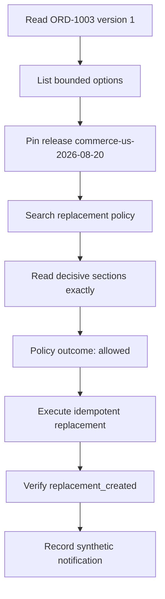

# Part 4: Run the demo and follow one order

This chapter shows how the demo is triggered and then explains one successful
recovery using evidence captured from the live Kind cluster.

## Before running it

Run every lifecycle operation through this example's `setup.sh`. The script
builds the three images, loads them into Kind, prepares configuration and the
agent-owned skill, applies the manifest, and waits for the rollouts.

From `truva-g3-domain-examples/agentic-commerce` after bootstrapping the sibling
`truva-g3` workspace:

```bash
cd ../../truva-g3/examples/travel-chat-agent
./setup.sh full-deploy
cd ../../../truva-g3-domain-examples/agentic-commerce
./setup.sh deploy
./setup.sh status
./setup.sh skills-check
./setup.sh test
```

The first two commands are needed only when the shared cluster and
infrastructure do not exist. Use this example's `rebuild` after a code change
and `rollout` after configuration-only changes.

The agent needs a supported AI provider key in
`order-operations-agent/.env`. Component-specific values stay in each
component's own `.env` file.

## Run the default demonstration

```bash
./setup.sh demo
```

The command resets synthetic Commerce state and then demonstrates five outcome
classes in order:

1. a normal order handled without an agent or LLM;
2. an automatic recovery;
3. a recovery left pending for human approval;
4. a deterministic denial;
5. an insufficient-evidence abstention.

The approval checkpoint is intentionally left pending. An unattended script
must not make the human choice.

## What a captured default run produced

This is the sanitized evidence from the passing live run. A new run creates new
IDs.

| Scenario | Task or direct path | Execution | Result |
|---|---|---|---|
| Normal order | direct `process_normal_order` for `ORD-1000` | no orchestration execution | `normal_order_confirmed`; agent and LLM both false |
| Automatic recovery | `order-event-demo-automatic-recovery-1787446133-56209` | `order-operations-1787446133236523689` | `recovered` / `allowed` |
| Approval required | `order-event-demo-high-value-missing-1787446198-56209` | `order-operations-1787446198299432013` | `approval_required`; checkpoint `cp-d038488b-15be-48` left pending |
| Denied option | `order-event-demo-denied-option-1787446249-56209` | `order-operations-1787446249150766084` | `denied`; no mutation |
| Insufficient evidence | `order-event-demo-insufficient-evidence-1787446320-56209` | `order-operations-1787446320312228629` | `insufficient_evidence`; no mutation |

The automatic, approval, denial, and abstention executions each recorded one
activation of skill version 8. Their Jaeger trace IDs were respectively:

```text
f3952cb932773e34bedaff89cd2df4b5
acce2e2a405618eb739a02469d820a8b
305816f77fbb7cf99121a031dd1b648c
d43594ea36ada7b9d408a8ec5bc23355
```

## How the automatic run was triggered

The setup script did not call the agent's LLM endpoint directly. It:

1. loaded `scenarios/automatic-recovery.json`;
2. replaced its checked-in event ID with a unique value;
3. posted the event to
   `http://agentic-commerce.localhost/webhook/order-risk`;
4. received HTTP 202 with a task ID and status URL;
5. polled the task until its terminal outcome became `recovered`;
6. asserted that the observed outcome matched the scenario contract.

The webhook-to-task transition is therefore part of the demo, not bypassed by
an internal function call. The normal-order case is the intentional exception:
it proves that healthy straight-through work bypasses the agent.

## Follow the captured automatic recovery

The order was `ORD-1003`, a 69 USD paid order that was missing in transit.
Replacement inventory was available, fraud risk was low, and the merchandise
was not restricted.

The Registry record
`order-operations-1787446133236523689` shows this progression:



The decisive evidence sections were:

- `demo-auto-recovery-bounds`;
- `demo-approval-thresholds`;
- `demo-evidence-precedence`.

The deterministic evaluator returned `allowed` with
`approval_required=false`. Commerce Core executed idempotency key
`ORD-1003:same-sku-replacement:v1`, moved the order from version 1 to version 2,
and returned command `04b5662a4dcbd22caccebc97373aa2e1`.

Verification returned `verified=true` and
`fulfillment_status=replacement_created`. Only then did Commerce Core record
notification `824200a8e21252fa06d00903e63e251d`.

Jaeger trace `f3952cb932773e34bedaff89cd2df4b5` connects the agent, Commerce Core, and
Domain Knowledge Gateway calls. Registry records skill version 8, one
activation, four planning-phase content loads plus the synthesis load, and the
tool results. `has_hitl_data=false` is correct because this 69 USD bounded
replacement did not require approval.

A read-only recheck of the retained live data while this tutorial was written
returned:

```json
{
  "registry_success": true,
  "skill_version": 8,
  "activation_count": 1,
  "content_load_count": 5,
  "step_count": 11,
  "decision": "allowed",
  "command_status": "completed",
  "command_replayed": false,
  "verified": true,
  "final_fulfillment_status": "replacement_created",
  "jaeger_span_count": 126,
  "jaeger_services": [
    "commerce-core",
    "domain-knowledge-gateway",
    "order-operations-agent"
  ],
  "jaeger_error_span_count": 0
}
```

This recheck used narrow API projections so it did not print signed evidence
receipts, decision tokens, or provider data.

## Trigger one fixture yourself

Use a unique event ID because duplicate IDs are rejected for 24 hours:

```bash
jq --arg event_id "tutorial-auto-$(date +%s)" \
  '.event_id = $event_id' scenarios/automatic-recovery.json |
  curl -sS -X POST \
    http://agentic-commerce.localhost/webhook/order-risk \
    -H 'Content-Type: application/json' \
    --data-binary @-
```

The response looks like this:

```json
{
  "status": "accepted",
  "retry": false,
  "task_id": "order-event-<your-event-id>",
  "status_url": "/api/v1/tasks/order-event-<your-event-id>"
}
```

Poll the returned URL:

```bash
curl -sS \
  "http://agentic-commerce.localhost/api/v1/tasks/<task-id>" |
  jq '{task_id,status,result,error}'
```

The terminal task result supplies the Registry `request_id`. Use Part 8 to
inspect that execution without exposing signed evidence or approval material.

Next: [Part 5: Progressive decision scenarios](05-decision-scenarios.md).
