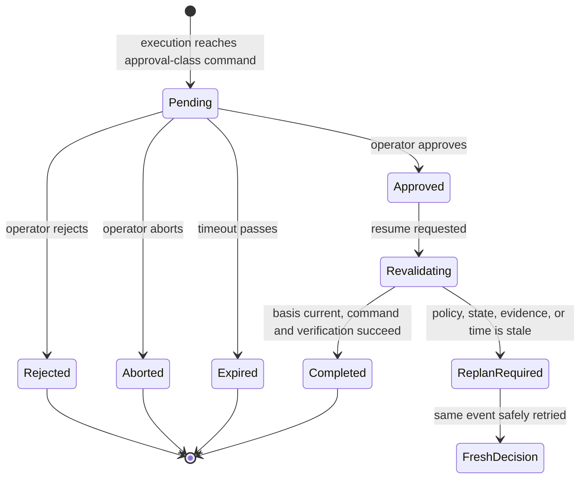

# Part 6: Human approval and change safety

Human approval is not a yes/no prompt wrapped around an unsafe command. It is a
persisted interruption before the command, followed by fresh validation at
resume time.

## When the checkpoint is created

Commerce Core first returns `approval_required` and a decision token. That
policy result alone is not yet a checkpoint.

The framework creates the checkpoint when it is about to dispatch
`execute_recovery_command`. It stores the interrupted step and its required
downstream chain:

```text
execute -> verify -> notify
```

This means an approved resume continues the complete safe path. It cannot stop
after an HTTP 200 from execute and incorrectly report success without
verification.

## Approval lifecycle



The demo timeout is ten minutes. Evidence and decision material are also
short-lived and revalidated before mutation.

## Operator commands

List checkpoints, make a decision, and resume an approved checkpoint through
the agent ingress:

```bash
curl -sS http://agentic-commerce.localhost/hitl/checkpoints
```

```bash
curl -sS -X POST \
  http://agentic-commerce.localhost/hitl/command \
  -H 'Content-Type: application/json' \
  -d '{"checkpoint_id":"<checkpoint-id>","type":"approve"}'
```

```bash
curl -sS -X POST \
  http://agentic-commerce.localhost/hitl/resume/<checkpoint-id>
```

Use `reject` instead of `approve` to reject. Approval is persisted before the
resume call. A rejection, abort, or expiry is terminal and reconciles the
original task without dispatching a command.

## A successful approval run

| Identifier | Value |
|---|---|
| Event/task | `manual-approval-governed-20260822-a10` / `order-event-manual-approval-governed-20260822-a10` |
| Initial request / trace | `order-operations-1787431818524531555` / `524e1fa80d7e5f6e5ffc21523966c956` |
| Checkpoint | `cp-171eded2-66d8-42` |
| Resume request / trace | `order-operations-1787431933621096526` / `207425146712467f4bdb4c10f0f2326c` |
| Command / notification | `fe9dca8f095a40f98b140129ad12c606` / `994deeea095c5748b0be2aa97c86dac3` |

Before approval, `ORD-1004` was version 1, missing in transit, and had no
recovery. The initial Registry execution recorded skill version 8, one
activation, nine successful pre-checkpoint steps, and the complete
execute/verify/notify continuation.

After approval, resume returned HTTP 200 with `terminal_outcome=recovered` and
`policy_outcome=approval_required`. The command completed, verification returned
`verified=true`, one notification was recorded, and the order became version 2
with `fulfillment_status=replacement_created`.

The initial and resume Jaeger traces contained 114 and 34 spans respectively;
the resume trace had zero error spans.

## Rejection and expiry

These paths prove that a checkpoint is not merely a pause in the UI. It controls
the original asynchronous task.

| Path | Live evidence | Result |
|---|---|---|
| Rejected | task `order-event-live-hitl-reject-1787445068`; execution `order-operations-1787445068234586699`; checkpoint `cp-d14768e3-1068-43`; trace `d292efda7d9e669cb81f71fa98e4cc1e` | task became `approval_rejected`; no command; order remained version 1 |
| Expired | task `order-event-live-hitl-expiry-1787445211`; execution `order-operations-1787445211258687939`; checkpoint `cp-fb1a7977-3c10-49`; trace `7b54eb2a1ab46f4090c1c37cd46ea713` | task became `approval_expired`; checkpoint `expired_rejected`; no command |

An abort follows the same reconciliation mechanism and ends as
`approval_aborted`.

## State changed while a person was deciding

For the state-race test, the order was version 1 when the checkpoint was
created. A hidden test control then made inventory unavailable and advanced the
order to version 2.

The person approved the old checkpoint, but Commerce Core compared the token's
version with current state before mutation.

Final proof:

| Identifier | Value |
|---|---|
| Task | `order-event-live-state-no-llm-1787455268` |
| Initial request | `order-operations-1787455268746308032` |
| Checkpoint | `cp-3b2dd5b7-4c02-49` |
| Resume request / trace | `order-operations-1787455319493659830` / `c05ae0bfcdf2b907eb7b565b63561ce7` |
| Result | HTTP 409, `state_changed_during_hitl`, `replan_required` |

The checkpoint became aborted. The only version change came from the explicit
test control; no recovery executed.

## Policy changed while a person was deciding

For the policy-race test, both the gateway release and Commerce Core's policy
release changed before approval.

Final proof:

| Identifier | Value |
|---|---|
| Task | `order-event-live-policy-no-llm-1787455334` |
| Initial request | `order-operations-1787455334827615843` |
| Checkpoint | `cp-d1f96f7b-94c2-45` |
| Resume request / trace | `order-operations-1787455389634165126` / `80f5d8d9cede1f8ae010d0aba248e871` |
| Result | HTTP 409, `policy_changed_during_hitl`, `replan_required` |

The order stayed at version 1 and no recovery executed. The three error spans in
the resume trace are expected proof of the guarded HTTP 409, not an uncontrolled
failure.

## A fresh approval after policy change

`ORD-1007` is worth 349 USD. The policy threshold changed to 300 USD while its
first approval was pending. The old checkpoint was rejected as stale. Reposting
the same event created a new decision and a distinct checkpoint against the new
release; the changed threshold still required approval.

| Stage | Request |
|---|---|
| Old decision | `order-operations-1787445946381889583` |
| Fresh decision and checkpoint | `order-operations-1787446024682060648` |
| Approved fresh resume | `order-operations-1787446065452372818` |
| Resume trace | `054bf1126255bd68b8c8b4b34105f1a4` |

The fresh approval recovered the order exactly once. The old approval never
authorized the new decision.

## Approval proof and privacy

On resume, the agent runtime generates an approval proof bound to the checkpoint,
decision token, and idempotency identity. A user does not type or fabricate this
proof. Commerce Core rejects approval-class execution without it.

The raw proof is needed only for the guarded HTTP dispatch. Framework redaction
now ensures that it is not recoverable from persisted step parameters,
resolution metadata, logs, traces, or LLM debug prompts. The final state- and
policy-race scans found:

- redaction markers in the expected structured fields;
- zero proof-shaped values in Registry unified JSON;
- zero proof-shaped values in checkpoint projections;
- zero proof-shaped values in Jaeger and current workload logs;
- no LLM error-repair or semantic-retry call containing the sensitive
  parameters.

Historical audit rows are intentionally retained as proof that the earlier leak
existed; the tutorial never reproduces those values.

## A Registry Viewer caveat

The authoritative checkpoint and task APIs reconcile these lifecycles correctly.
Registry Viewer still stores the initial interruption and the resume as separate
execution snapshots. Until its lifecycle-join issue is fixed, manually connect
them using `original_request_id` and checkpoint ID. Part 8 explains this in
context.

Next: [Part 7: Using the pattern in another domain](07-domain-portability.md).
