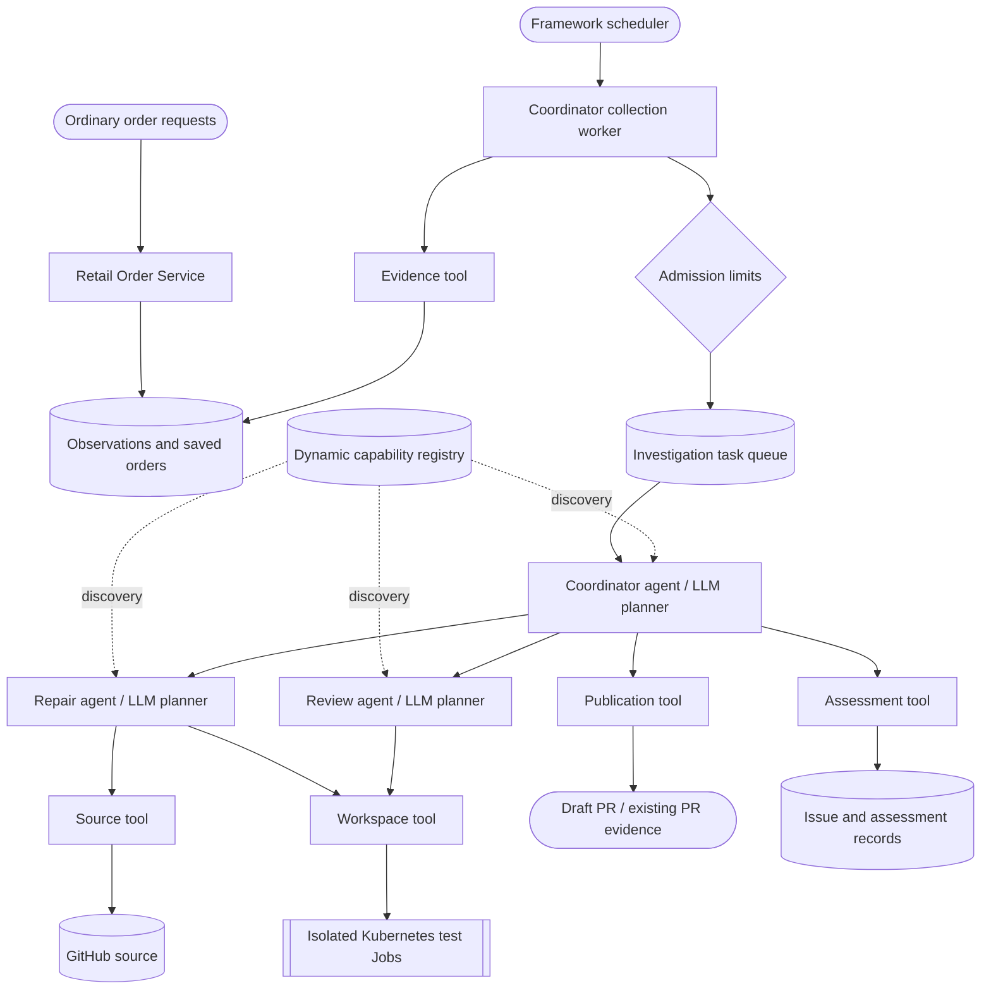

# Autonomous Software Maintenance

An example of a bounded maintenance system built with TruvaG3: ordinary service
traffic produces observations, a scheduler admits cases, and specialist agents
investigate, develop a candidate, independently review it, and may open a **draft**
pull request. The model chooses its next actions from capabilities discovered in
the registry. This is not a hardcoded repair pipeline.

The current target is the separate [Retail Order Service](https://github.com/truvaagents/retail-order-service).
It is planned for public release after its safety review. Until then, repository
access is restricted; a missing/inaccessible link does not indicate a setup error.
The solution contains **three agents and five passive tools**. It does not merge
PRs, deploy repairs, or establish that production has been fixed.

For the illustrated, evidence-backed execution walkthrough, read
[Beyond Monitoring: Detecting and Repairing Functional Defects with Agents](https://truvag3.dev/blogs/software-maintenance-in-action).
It follows the setup, scheduling, skills, model prompts, source inspection,
sandbox testing, review and draft publication, then a repeat investigation with
the PR still open. Use that article to understand the recorded runs; use this
README for the current setup and operational requirements.

## Setup

> **Framework version:** this example pins the published TruvaG3 **v0.6.0**
> modules and requires **Go 1.27.2 or newer**. Release builds are the default;
> no local framework replacements are needed. A framework checkout is still
> required for shared setup helpers and infrastructure; use v0.6.0 or a reviewed
> compatible newer checkout. Fresh-install live
> acceptance remains a separate gate; see Public-release readiness below.

**Start here:** clone the sibling repositories and bootstrap shared infrastructure
through the travel example, then configure credentials/profiles and the target
service. Deploy all eight maintenance components with collection disabled,
verify readiness, then enable a bounded traffic-driven run. A deployed coordinator
alone is not the complete solution.

### On this page

- [Setup](#setup): [prerequisites](#prerequisites), [clone and bootstrap](#clone-and-bootstrap-the-framework-once), [your own repository](#use-your-own-repository-for-the-demo), [credentials and policy](#configure-credentials-and-policy), [deployment](#deploy-the-complete-solution)
- [Architecture and responsibilities](#architecture-and-responsibilities)
- [How an investigation works](#how-an-investigation-works)
- [Operational triggers and run controls](#operational-triggers-and-run-controls): [environment variables](#admission-environment-variables), [capacity and replicas](#what-happens-when-capacity-is-reached), [operator checklist](#operator-checklist-for-a-bounded-session), [continuous-monitoring boundary](#continuous-monitoring-current-boundary-and-recommended-extension)
- [Skills, profiles and evidence](#skills-profiles-and-evidence)
- [Profile preparation guide](PROFILE_SETUP_GUIDE.md): worked fork example, service version, hash-update order and troubleshooting
- [Run an automatic investigation](#run-an-automatic-investigation)
- [Inspect and verify the outcome](#inspect-and-verify-the-outcome)
- [Budgets and timeouts](#budgets-and-timeouts)
- [Operations and troubleshooting](#operations-and-troubleshooting)
- [Public-release readiness](#public-release-readiness)
- [Extensibility and remaining boundaries](#extensibility-and-remaining-boundaries)
- [Development references](#development-references)

### Prerequisites

- Go 1.27.2+, Bash, Git, jq, curl, OpenSSL, shasum, kubectl, Kind, and Docker or Podman.
- The domain-examples and framework checkouts as siblings, or an explicit
  `TRUVAG3_ROOT` pointing at the framework checkout. The framework owns shared
  infrastructure; this directory owns only maintenance workloads.
- Shared infrastructure reachable in `truvag3-examples`: Redis, ingress, OTEL,
  Loki, Prometheus, Jaeger, Grafana, Skills API and Registry Viewer.
- Authorized access to the separate Retail Order Service repository, and its
  deployed service with actual persisted outcomes and build provenance. Follow
  that repository's README and `setup.sh`; this solution does not deploy it.
  The order-submission credential is used by the traffic helper, not the evidence
  tool: the current evidence adapter reads the service's evidence endpoints
  without attaching that token. Keep those endpoints appropriately isolated.
- GitHub repository access and at least one AI provider key for the agents.
- Enough Kind worker resources for the control-plane pods plus sandbox Jobs.
  Each runner requests 250m CPU / 768 MiB RAM / 1 GiB ephemeral storage and can
  use 2 CPU / 3 GiB RAM / 4 GiB ephemeral storage. The workspace also uses a PVC.
- Verified network isolation before accepting untrusted code. A digest-pinned
  runner or a NetworkPolicy manifest alone does not prove enforcement.

### Clone and bootstrap the framework once

First follow the framework's [Getting Started guide](https://github.com/truvaagents/truva-g3/blob/main/GETTING_STARTED.md)
for your platform's prerequisites, Docker/Podman setup and local ingress access.
This example uses the same bootstrap path as the domain repository's Agentic
Commerce example: the maintained **travel-chat-agent** setup installs shared
infrastructure. Travel is the bootstrap entry point, not a functional dependency
of software maintenance.

From your chosen workspace parent directory, clone both repositories as siblings
(skip the clone command for a checkout you already have; preserve local work):

```bash
git clone --branch v0.6.0 https://github.com/truvaagents/truva-g3.git
git clone https://github.com/truvaagents/truva-g3-domain-examples.git
cd truva-g3/examples/travel-chat-agent
./setup.sh help
# Create configuration only when absent; preserve existing credentials.
if [ ! -f .env ]; then cp .env.example .env; fi
# Edit this travel agent's .env and supply one supported AI provider key.
```

For a **cold start**, after configuring the provider:

```bash
./setup.sh full-deploy
```

This creates the default Kind cluster `truvag3-demo-$(whoami)`, installs shared
Redis, ingress, observability and Registry Viewer, and deploys the travel agent
and chat UI. Let the setup script finish successfully. Use the Getting Started
guide's troubleshooting if it fails; do not create a replacement cluster or
hand-apply infrastructure manifests to bypass a failure.

**Already have the intended cluster and healthy shared infrastructure?** Reuse
them and skip `full-deploy`; there is no need to redeploy travel or add travel
tools just to run maintenance. Confirm the intended kubectl context, shared pods
and local ingress before proceeding:

```bash
kubectl config current-context
kubectl get pods -n truvag3-examples
curl --fail --silent --show-error http://registry.localhost/health
```

Check pod readiness, and open `http://registry.localhost/` and
`http://jaeger.localhost/`. These are infrastructure checks, not paid LLM tests
or proof of a working maintenance run. The travel chat/tool demonstrations in
Getting Started are optional for this solution.

If you followed the clone commands above, return from the travel-agent directory:

```bash
cd ../../../truva-g3-domain-examples/software-maintenance
./setup.sh help
```

Continue below with your retail-service fork, component credentials and profiles.
The travel agent's `.env` is **not inherited** by the maintenance agents; configure
their own files. Shared infrastructure remains owned by the framework checkout;
`software-maintenance/setup.sh full-deploy` deliberately refuses to create it.

### Use your own repository for the demo

Follow the [Profile preparation guide](PROFILE_SETUP_GUIDE.md) for the worked
example and copyable fingerprint-update steps. It explains which files to edit,
which values to retain, and how to validate the result before enabling collection.

**Recommended: fork Retail Order Service and open the demo PRs inside your own
fork.** Reading public source is not permission to create branches in upstream.
This publication tool creates a branch and a draft PR in the **same configured
repository**, and validates that both PR head and base belong there. It does not
implement a fork-to-upstream contribution workflow. No upstream write access is
needed when source, deployment and publication all refer to your fork.

After the service's safety review and public release, fork through GitHub and clone your fork as the local
`retail-order-service` directory beside the framework checkout. Retain Git history;
the contract commit referenced by the profile must exist in that repository.
Choose a baseline commit whose behavior you intend to investigate, deploy that
exact committed source, and leave the resulting repair PR unmerged for the
duplicate-avoidance check. A repository already containing a repair is not an
equivalent reproduction of the blog's historical run.

| Setting / evidence | Required alignment for `YOUR_OWNER/retail-order-service` |
| --- | --- |
| Service build provenance | `/build-info.repository` names the fork; `git_revision` exists there and `source_matches_commit` is true |
| `retail-order-service.json` | `repository.name` names the fork; default branch and immutable contract reference exist there; upstream URL points to your deployed instance |
| `retail-order-source.json` | `owner` / `repository` name the fork; `default_ref` and `allowed_named_refs` allow its chosen base branch |
| `retail-order-publication.json` | `owner` / `repository` name that same fork; `base_ref` is its base branch, normally `main`; configure your own bot author identity |
| Logical IDs | Keep `repository_id`, service/workspace/profile IDs consistent across all profiles; the current logical IDs can stay unchanged for a single installation |
| Integrity pins | Propagate the changed service version and raw-file prerequisite hashes before deploying consumers; see [safe profile changes](#readiness-and-safe-profile-changes) |

Use repository-scoped credentials belonging to you: source `GITHUB_TOKEN` needs
Contents read access; publication `GITHUB_WRITE_TOKEN` needs Contents and Pull
requests read/write access plus Metadata read access on your fork. A fine-grained
PAT is sufficient for a personal demo; an organization can use its approved bot
or GitHub App credentials. Repository rules and organization approval still apply.
Review Actions behavior before allowing generated branches; do not grant workflow
editing for this example. See GitHub's [token guide](https://docs.github.com/en/authentication/keeping-your-account-and-data-secure/managing-your-personal-access-tokens)
and [endpoint permission reference](https://docs.github.com/en/rest/authentication/permissions-required-for-fine-grained-personal-access-tokens).

**Release prerequisites:** the maintainers will review the target service for
safe public consumption before making it public. Public release is a maintainer
action, not part of the user's setup procedure. Until then, only explicitly
authorized users can access it; external readers should wait for release rather
than request upstream write permissions. The intended public walkthrough uses
each reader's own fork, credentials and local deployment.

There is also a separate portability prerequisite: the inspected retail-service
`setup.sh` writes `truvaagents/retail-order-service` into build provenance and
`build.go` requires that literal. The evidence tool compares that value against
the service profile. Therefore **forking and editing profiles alone is not yet
a working setup**. The target service needs a reviewed repository-identity
configuration/build change, preserving provenance validation, before this path
can be live-verified. Do not bypass the comparison or label upstream provenance
as belonging to your fork. This is a target-service portability item, not a new
planner or framework capability.

Once that prerequisite is available, prepare the service profile first. With
collection disabled, deploy/rebuild the evidence tool and read its authenticated
`get_service_profile` response to obtain the canonical `profile_version`.
Update repair/review/coordinator service-version pins; edit the source and
publication repository settings and propagate raw-file pins in dependency order.
Then run the complete validation/deployment sequence below. Do not enable paid
investigations until source, service provenance and publication target agree.

### Configure credentials and policy

From this directory:

```bash
./setup.sh help
./setup.sh init-config
# Edit root .env for shared non-secret settings.
# Fill credentials in each agents/<name>/.env and tools/<name>/.env.
# Review ready profiles and authorize the safety/write gates below first.
./setup.sh validate
```

Each component owns its credentials; [.env.example](.env.example) contains only
shared, non-secret runtime defaults. Component `.env.example` files list local
credentials and settings. Load order is shared root settings, then the selected
component. The explicit `MAINTENANCE_FRAMEWORK_SOURCE` invocation and diagnostic
overrides documented below take precedence. Keep credentials out of Git.

Upgrading a preserved copy with an old all-in-one root `.env`? Run
`./setup.sh migrate-config` **before** `init-config`. It preserves the entire
original in an ignored, private `.env-migration.*/original.env`, copies only
known settings into their owners' files, and refuses to overwrite existing
component `.env` files. Run `validate` after migration.

`validate` checks every component separately, compares caller/receiver
identities and coordinator/assessment summary limits, and verifies the supplied
profiles' raw-file dependency pins. It does not contact an AI provider, verify GitHub permissions, or
prove network isolation. Ready workspace/publication profiles still require
their explicit safety/write settings before validation can pass.

The supplied Kubernetes manifests explicitly set profile paths, service URLs,
Redis connection/namespace, component identity and telemetry endpoints. These
inline `env` entries take precedence over ConfigMap values generated from `.env`.
Changing a local `*_PROFILE_FILE` / `*_PROFILES_FILE` setting alone therefore does
not change the deployed profile. Edit the shipped profile files and rebuild, or
deliberately adapt the manifests for a different topology. Local `run` uses the
component's environment instead; profile-pin preflight covers the supplied
Kubernetes profile set, not arbitrary local profile paths.

#### Identity wiring

Generate one random secret per identity (`openssl rand -hex 32`), and reuse it
only at the matching caller/receiver bindings below. Each identity is distinct.

| Identity | Variables that must carry the same value |
| --- | --- |
| Coordinator | MAINTENANCE_AGENT_SERVICE_TOKEN; MAINTENANCE_EVIDENCE_COORDINATOR_TOKEN; MAINTENANCE_SOURCE_COORDINATOR_TOKEN; MAINTENANCE_WORKSPACE_COORDINATOR_TOKEN; MAINTENANCE_PUBLICATION_COORDINATOR_TOKEN; MAINTENANCE_REPAIR_COORDINATOR_TOKEN; MAINTENANCE_REVIEW_COORDINATOR_TOKEN |
| Repair | MAINTENANCE_REPAIR_SERVICE_TOKEN; MAINTENANCE_EVIDENCE_REPAIR_TOKEN; MAINTENANCE_SOURCE_REPAIR_TOKEN; MAINTENANCE_WORKSPACE_REPAIR_TOKEN |
| Review | MAINTENANCE_REVIEW_SERVICE_TOKEN; MAINTENANCE_EVIDENCE_REVIEW_TOKEN; MAINTENANCE_SOURCE_REVIEW_TOKEN; MAINTENANCE_WORKSPACE_REVIEW_TOKEN |
| Workspace → source | MAINTENANCE_SOURCE_WORKSPACE_TOKEN |
| Publication → workspace | MAINTENANCE_WORKSPACE_PUBLICATION_TOKEN |
| Publication → review | MAINTENANCE_REVIEW_PUBLICATION_TOKEN |
| Operator | MAINTENANCE_AGENT_API_TOKEN; also accepted by the assessment tool's operator endpoints |

Configure each variable in the component that consumes it. For example, the
coordinator's outbound token belongs in `agents/maintenance-agent/.env`, while
its matching evidence identity belongs in `tools/maintenance-evidence-tool/.env`.
Three names are shared across two owners: `MAINTENANCE_SOURCE_WORKSPACE_TOKEN`
in source/workspace, `MAINTENANCE_WORKSPACE_PUBLICATION_TOKEN` in
workspace/publication, and `MAINTENANCE_REVIEW_PUBLICATION_TOKEN` in
review/publication. Assessment's operator/coordinator tokens and summary limit
match the coordinator's settings. `validate` rejects mismatched credentials and
resolved summary limits. Unset summary limits default to 10,000 bytes; explicit
values must be integers from 1 to 65,536. To override the coordinator limit,
set `MAINTENANCE_AGENT_MAXIMUM_SUMMARY_BYTES` identically in coordinator and
assessment configurations (or once in root `.env`, without conflicting component
overrides). Their separate deployments must resolve the same profile identity.

Set `GITHUB_TOKEN` for source read access (Contents/Metadata) and
`GITHUB_WRITE_TOKEN` for publication (Contents/Pull requests plus required
repository metadata access). Repository policy may impose additional conditions.
Keep Actions/workflow paths denied and grant only the repository scope required.
The shipped commit author is a placeholder, not the developer's personal identity;
configure an organization-owned bot identity before real publication and repin.

Set `OPENROUTER_API_KEY` in **each agent's** `.env` to use the exercised OpenRouter configuration. Leave
other provider keys empty if you want to force that route. The template routes
planning to `openai/gpt-6.1-sol`, synthesis/default work to
`deepseek/deepseek-v4.1-flash`, and fast auxiliary work to
`openai/gpt-6-luna`. These are explicit example choices, not promises about
framework defaults. Tools do not need AI keys.

#### Readiness and safe profile changes

New to profile pins? Start with [Understand the fingerprints](PROFILE_SETUP_GUIDE.md#understand-the-fingerprints)
and the [worked fork example](PROFILE_SETUP_GUIDE.md#worked-example-your-own-fork).

Collection is disabled in the shipped coordinator profile. Other profiles carry
ready settings from verified development work. The component templates deliberately keep
network attestation and publication writes off; filling secrets alone is not
enough to run those ready profiles.

- Confirm the service URL, repository, contract commit, serving release and all
  prerequisite pins describe the deployment you own.
- Set `MAINTENANCE_NETWORK_ISOLATION_ATTESTED=true` only after verifying actual
  isolation. `MAINTENANCE_FUNCTIONAL_ACCEPTANCE_MODE=true` is a development-only
  exception, not evidence of production security.
- Set `MAINTENANCE_PUBLICATION_ENABLE_WRITES=true` only when explicitly allowing
  draft PR creation and after reviewing GitHub permissions.
- Keep collection disabled and drain active cases before editing policy/pins.

Source/workspace/repair/review/publication profile pins hash the **exact file
bytes** (`shasum -a 256 profiles/<file>.json`). Propagate changed prerequisite
hashes in dependency order: source/workspace → repair/review → publication →
coordinator. The service's `profile_version` instead hashes its typed canonical
representation: obtain it from the evidence tool's authenticated
`get_service_profile` response, not a raw-file checksum. The coordinator also
incorporates its resolved summary limit into runtime identity.

`validate` and each `deploy`/`rebuild`/`rollout` reject stale raw-file pins before
cluster mutation; they do not rewrite pins automatically. They also require
repair, review and coordinator to declare the same service profile version.
That agreement does **not** prove the version matches the evidence tool's
canonical value: obtain and compare its authenticated response as described
above. Runtime profile/receipt validation remains authoritative.

Rebuild every affected component; the coordinator profile is baked into both the
coordinator and assessment tool. Old receipts remain historical, not authority
under new publication pins. Do not cut over with a case in flight.

### Deploy the complete solution

Expected layout:

```text
workspace/
├── truva-g3/                    # framework + shared infrastructure
└── truva-g3-domain-examples/
    └── software-maintenance/    # this solution
```

For another layout, export `TRUVAG3_ROOT=/absolute/path/to/truva-g3`.
That checkout supplies the shared setup/skills helpers; workspace-image builds
also use its framework modules. Published-release builds do not import its Go
sources.

1. **Confirm the earlier bootstrap is complete.** Follow
   [Clone and bootstrap the framework once](#clone-and-bootstrap-the-framework-once)
   if this is a cold start; otherwise reuse the verified shared infrastructure.
   The domain setup neither creates nor deletes the shared cluster or services.
2. **Configure Viewer domains.** In the framework's
   `examples/registry-viewer-app/.env`, include
   `TRUVAG3_VIEWER_MEMORY_DOMAINS=infrastructure,software-maintenance`, retaining
   other domains you use. Apply through that example's `setup.sh deploy`.
3. **Deploy the target service** through its own setup script. Confirm its build,
   contract revision, GitHub repository and evidence endpoints match the profiles.
4. **Select the intended Kind context and runtime.** The default cluster is
   `truvag3-demo-$(whoami)`; `CLUSTER_NAME` can select another existing Kind
   cluster. Setup rejects a different current kubectl context rather than
   modifying the wrong cluster. The supplied manifests use the fixed
   `software-maintenance` namespace and shared `truvag3-examples` services.
   Docker/Podman selection uses the framework helper; Podman on macOS needs
   a rootful machine.
5. **Validate and deploy**, from this directory, with collection disabled:

```bash
# Published dependencies; explicitly override any older workspace-mode setting.
export MAINTENANCE_FRAMEWORK_SOURCE=release
(
  set -e
  ./setup.sh validate
  ./setup.sh deploy-all
  ./setup.sh test-all
)
```

`deploy-all` validates all component configurations before cluster mutation,
then deploys evidence, source, workspace, repair, review, publication, assessment
and coordinator in that order. A failure stops the remaining deployments.
`test-all` runs each smoke check, strict skills comparison and preflight. These
scripts do not directly submit an investigation or call an AI provider. Deploying
with collection enabled can nevertheless start scheduled investigations and paid
model calls; keep collection disabled during setup verification.

For targeted changes, use `deploy <component>`, `rebuild <component>` for a
no-cache code/image rebuild, or `rollout <component>` for configuration only.
Without a component, those verbs still target **evidence only**. Use
`deploy-all` for the complete solution.

For framework development only, explicitly select
`MAINTENANCE_FRAMEWORK_SOURCE=workspace` and point `TRUVAG3_ROOT` at the reviewed
framework checkout. This is not required for normal installation.
Workspace builds create a private temporary context from the selected
component, internal code, profiles and required framework modules. Both Docker
and Podman get a context-root ignore policy. Local environments, backups and
investigation notes are excluded, and host module files are not rewritten.
`build`/`run` remain published-dependency paths; the workspace option applies
only to container builds.

Agent deployment and rollout attempt skill synchronization before restart.
`skills-sync` and `skills-check` remain strict operator commands. Runtime
readers and the management API must share Redis topology/namespace (supplied
manifests use DB 0, namespace `default`).

The smoke checks verify selected endpoints and success envelopes, not a full
repair. They use the shipped profile IDs and source branch `main`; a custom
installation that changes those identifiers/branch must adapt the smoke probes
as well as the profiles. Preflight verifies Viewer domain visibility, bounded admission and
matching coordinator/assessment profile bytes—not backend health, provider
credentials or complete evidence access. It first checks the selected Kind
cluster/context and local profile/summary consistency. Live profile-byte checks
apply when admission is enabled; they do not attest every live environment value.
Finish with the traffic-driven
verification below.

## Architecture and responsibilities



Arrows show available interactions, not compulsory planning steps. Agents may
read evidence or prior work, request more information, stop inconclusively, or
decline to propose a change. Discovery is dynamic; the diagram is not an agent
allowlist.

| Component | Responsibility | Container port |
| --- | --- | ---: |
| `maintenance-agent` | Schedules collection, admits bounded tasks, orchestrates investigation, records case outcomes and assessment handoffs | 8398 |
| `maintenance-repair-agent` | Reasons about source and develops a candidate using discovered capabilities | 8400 |
| `maintenance-review-agent` | Independently evaluates the candidate and verification evidence; issues a scoped review receipt | 8402 |
| `maintenance-evidence-tool` | Reads the service contract profile, observation feed, saved outcomes and serving/build context | 8397 |
| `maintenance-source-tool` | Resolves immutable Git revisions, searches/lists/reads bounded source, creates source snapshots | 8399 |
| `maintenance-workspace-tool` | Owns workspaces, candidates, Kubernetes Jobs, artifacts and verification receipts | 8401 |
| `maintenance-publication-tool` | Reads existing PRs and changes; validates receipts and publishes draft-only changes | 8403 |
| `maintenance-assessment-tool` | Deterministic issue/assessment storage and applicability checks; no LLM | 8404 |

All eight register with shared discovery. Only agents run the orchestration
planner. The assessment tool's internal recording endpoint is called by
coordinator bookkeeping; it is not an autonomous agent execution.
Tools can read explicitly configured, authenticated internal evidence endpoints;
they do not discover peers or choose a plan.

Maintenance workloads use namespace `software-maintenance`. Shared Redis,
collectors, dashboards and the target service use `truvag3-examples`.
Service ClusterIP port 80 maps to the container ports above. Local ingress hosts
use the component name, for example `http://maintenance-agent.localhost`.
The workspace tool alone needs Kubernetes permissions to manage its sandbox Jobs.

## How an investigation works

1. **Observe real traffic.** The order service writes its business outcome and
   exposes a bounded observation feed. An observation is a lead, not proof that
   the business operation was correct.
2. **Collect without an LLM.** The framework scheduler runs collection once a
   minute by the shipped profile. It reads a five-minute window with overlap
   and watermark handling. Failed requests are selected; successful observations
   use deterministic one-in-five sampling. This is not a guarantee that every
   functional defect will be sampled.
3. **Admit a bounded case.** Case identity deduplicates repeated observation
   admission. Persistent run quotas bound cases, pending work and duration.
   Sampling calls are not full agent runs. Admission failures and incomplete
   feed coverage remain visible.
4. **Plan using evidence.** The coordinator receives the case, runtime catalog,
   applicable skills and recalled memory. It reads the owner-approved contract
   at an immutable revision, actual service evidence and saved outcomes.
5. **Inspect code selectively.** The source tool provides bounded tree/search
   results and file slices; the model need not load the entire repository into
   its prompt. A separate bounded snapshot supplies actual bytes to the workspace.
6. **Develop and test when justified.** The repair agent can stage candidate
   bytes and regression-test artifacts. The workspace runs approved Go checks
   against baseline/candidate material in isolated Kubernetes Jobs. The model
   receives summaries and can request bounded artifact ranges. A Job is a
   Kubernetes workload, not a new agent.
7. **Review independently.** The review agent checks scope, changes, tests and
   trusted receipts. An approval is tied to exact candidate/verification facts,
   not merely to prose saying tests passed.
8. **Check prior work and publish.** Skills guide fresh PR discovery and
   comparison before proposing another PR. Publication also rejects matching
   production-file bytes already present in an open PR on the same base.
   Missing or incomplete read coverage does not authorize publication.
9. **Retain outcomes.** Case/task results, effects and assessments are separate
   from model-written episodic memory. GitHub effects can survive a later
   synthesis/validation failure; a created PR does not automatically make the
   overall orchestration lifecycle successful.

A successful diagnostic must establish the intended business result as well as
execution status. For a fresh repair, inspect the actual PR diff, baseline failure,
candidate checks, review and publication receipt. For a repeat, inspect the fresh
PR reads and verify no duplicate appeared. A blocked case with truthful prior-work
evidence is different from an accepted reusable assessment.

## Operational triggers and run controls

The automatic path is **traffic-driven, but scheduler-triggered**. Placing an
order does not call the maintenance agent immediately. The service exposes an
observation; the next scheduled collection reads it, applies sampling and
admission controls, and may queue an investigation. Collection and admission are
deterministic and do not call an LLM. Paid model work begins when a worker starts
an admitted investigation. A collection tick is not a full agent run.

There are two observation entry paths:

- **Scheduled collection (the normal demonstration):** the coordinator profile's
  `collection.enabled` turns polling on or off. The shipped schedule is once a
  minute, with a 300-second read window, 60-second overlap, at most 50 items per
  response and eight evidence calls per collection. Truncated ranges are split
  within that call budget. Non-2xx/error observations are selected; successful
  observations use a stable hash with `successful_sample_modulus=5`, so roughly
  one in five is selected, not exactly every fifth order. These settings live in
  `profiles/retail-order-maintenance.json`, not the admission environment variables.
  The current profile validator supports the once-per-minute cron expression.
- **Authenticated observation event:** `POST /api/v1/observations` can request
  admission for a specific observation without waiting for the schedule. It uses
  the same case identity and admission ledger when admission is enabled, but does
  not apply the collector's sampling filter. The caller owns any redelivery of a
  deferred event. This endpoint is not wired to retail order requests by default;
  using it does not prove the scheduled collection path. Direct task submission
  is rejected while admission controls are enabled.

Turning collection off disables scheduled collection, not the authenticated
observation endpoint, and does not cancel admitted tasks. Deploying an enabled
profile can start paid work from eligible observations without a manual agent
invocation. Keep external event producers stopped during setup or maintenance.

### Admission environment variables

Set these in `agents/maintenance-agent/.env`. They are read at startup, not
hot-reloaded. The values below are the **shipped `.env.example` values**, not the
settings from any particular diagnostic run.

| Variable | Template value | What it controls |
| --- | --- | --- |
| `MAINTENANCE_ADMISSION_ENABLED` | `true` | Enables shared admission accounting. Enabled collection requires it; setting it to `false` is not a continuous-monitoring mode. |
| `MAINTENANCE_ADMISSION_RUN_ID` | Operator-supplied; placeholder commented out | Names one persistent allowance. Use a fresh lowercase slug for a separately authorized run. It is not an order ID, case ID or LLM execution ID. |
| `MAINTENANCE_ADMISSION_MAX_CASES` | `1` | Total new cases admitted under this run ID, including those that later finish. Does not reset with the rolling window. |
| `MAINTENANCE_ADMISSION_MAX_PENDING` | `1` | Shared bound on outstanding reservations and queued/running investigations. Not a per-pod worker count. |
| `MAINTENANCE_ADMISSION_MAX_PER_WINDOW` | `1` | Maximum new admissions during the preceding `WINDOW`. Capacity becomes available as older admissions leave that rolling window. |
| `MAINTENANCE_ADMISSION_FAILURE_QUOTA` | `1` | Maximum failure-category admissions within that same rolling window. |
| `MAINTENANCE_ADMISSION_SUCCESS_QUOTA` | `1` | Maximum success-category admissions within that same rolling window. A successful HTTP request can still contain a functional defect. |
| `MAINTENANCE_ADMISSION_RUN_DURATION` | `1h` | Deadline for new admissions, measured from creation of the run ledger. Not a task, phase, model-call or sandbox Job timeout. |
| `MAINTENANCE_ADMISSION_WINDOW` | `5m` | Rolling interval for the total and category admission rates. Separate from the profile's observation read window. |
| `MAINTENANCE_ADMISSION_COOLDOWN` | `1m` | Minimum spacing between new reservations across replicas. A short cooldown does not make the once-per-minute schedule run more often. |

All applicable limits must allow an admission. Category quotas do not add to or
override `MAX_CASES` or `MAX_PER_WINDOW`. Re-observing an already admitted exact
case reuses its record instead of consuming another case allowance; uncertain
admissions remain deferred. One case can involve multiple delegated agents and
many model calls, so these controls are not a token or dollar budget.

When variables are absent, the loader uses run ID `default`, two total cases,
one pending case, two admissions per five minutes, one per category in that
window, a two-hour run duration and a one-minute cooldown. Admission enablement
defaults to the collection setting. Invalid explicit values fail startup.
Omitting variables therefore does **not** create an unlimited run. Choose an
explicit run ID operationally even though the loader permits `default`.

**The clock starts at ledger initialization:** with admission enabled, coordinator
startup creates the ledger even if collection is disabled. Enabling collection
an hour later does not give an existing one-hour run another hour. Check its
`started_at`, `deadline` and stored policy through authenticated
`GET /api/v1/admission` before sending traffic. Scheduled reads also exclude
observations older than this run's start; re-arming is not a historical replay.

To apply environment-only changes, use `./setup.sh rollout coordinator`.
Changing an admission policy under an existing run ID fails startup because the
stored policy must match. Drain existing work and use a fresh, explicitly
authorized run ID for a changed policy; otherwise old and new allowances can
overlap. Keep all coordinator replicas on the same policy. For profile changes,
including `collection.enabled`, rebuild assessment and coordinator as described
under [Run an automatic investigation](#run-an-automatic-investigation).

### What happens when capacity is reached

- **Temporary limit:** pending capacity, rolling-window quotas or cooldown defer
  new admissions. Scheduled collection can retry on subsequent ticks as capacity
  becomes available. Tasks already admitted may continue.
- **Run exhausted:** the cumulative case allowance or run deadline stops new
  admissions for that run. Neither a new polling tick, a pod restart nor elapsed
  rolling windows renew it. A fresh run ID requires an explicit operator action.
- **Uncertain handoff:** if task creation/queue handoff becomes ambiguous, the
  ledger stops further admissions with `ambiguous_handoff`. Investigate the
  existing task and case; changing the run ID is not a safe substitute for
  reconciliation and can duplicate work.

The admission ledger is in shared Redis, scoped by coordinator profile ID,
service profile ID and run ID. Three replicas using the same scope share one
allowance; they do not each get that allowance. Each coordinator pod defaults to
one investigation worker. Set `MAINTENANCE_INVESTIGATION_WORKERS` in the
coordinator's `.env` to an integer from 1 through 100, then use
`./setup.sh rollout coordinator`. Invalid explicit values fail setup/startup.
All coordinator replicas use the same ConfigMap: three replicas with three
workers each provide nine investigation-worker slots, subject to the shared
pending/rate limits and available compute. This does not raise admission quotas,
change sampling, or change the single collection worker per pod. Drain active
work before rolling out a capacity change; a restart is not durable recovery.
Setup reapplies the deployment manifest, whose replica count defaults to one.
After a rollout/rebuild, restore your intended replica count and verify ready
pods before calculating total worker capacity or starting a concurrency run.

Polling can continue after admission stops. When a selected observation is
deferred, the collector holds its watermark (the saved position in the feed)
rather than claim that interval was fully handled. It can reread that interval;
it does not necessarily move on to the newest traffic each minute. If it falls
behind the source's retention, it reports a coverage gap. The observation feed
is advisory: sampling, bounded enumeration and retention are not lossless intake.
Inspect collection dispositions, the admission ledger and case/task status, not
just the fact that the scheduler or pods are healthy.

### Operator checklist for a bounded session

The investigation is automatic; authorizing and starting each new allowance is
an operator action. Use this checklist for normal service traffic. Synthetic
orders are optional for a controlled demonstration, not required for operation.

1. **Prepare the service and verify readiness.** Configure the service's
   functional requirements, evidence endpoints, repository scope and permitted
   verification commands through the profiles. Deploy all eight components with
   collection disabled. Check credentials, skills, evidence access and sandbox
   isolation using the setup and preflight instructions above. Keep any external
   observation-event producers stopped until the session is authorized.
2. **Choose a session allowance.** In the coordinator's `.env`, keep admission
   enabled, choose a fresh run ID and set finite case, pending-work, rolling-rate,
   category and duration limits. Start with the conservative template values and
   increase only the limits needed for the intended workload. One admitted case
   can make many model calls: monitor provider usage and configure provider-side
   spending controls separately where available.
3. **Enable and check the session.** Follow
   [Run an automatic investigation](#run-an-automatic-investigation) to rebuild
   assessment and coordinator with collection enabled. Check the deployed
   admission policy and deadline through `/api/v1/admission`; startup starts the
   clock, not the first order. Eligible observations may trigger work as soon as
   collection is enabled. Environment edits alone do not update running pods.
4. **Let ordinary traffic drive investigations.** The scheduler polls the
   observation feed, selects samples and admits cases within the allowance.
   Workers invoke the coordinator, which chooses whether to investigate further,
   delegate repair/review, link existing remediation or propose a draft PR. There
   is no need to invoke an agent manually for each order.
5. **Monitor both intake and outcomes.** Watch admitted, reused, sampled-out and
   deferred observations, remaining allowance, deadlines and coverage gaps.
   Follow case/task states and related agent executions in the Registry Viewer;
   use traces and logs for failures. For a proposed repair, inspect the actual
   diff, verification evidence and review receipt. For existing remediation,
   check fresh PR evidence. A healthy pod, successful model response or open PR
   alone does not prove that the whole investigation succeeded.
6. **Finish, inspect and deliberately re-arm.** Let the case ceiling or admission
   deadline stop new admissions, then wait for outstanding work to finish before
   restarting components or changing policy. Reconcile uncertain handoffs first.
   To end scheduled monitoring, set `collection.enabled=false` and rebuild
   assessment and coordinator; also stop external observation-event producers.
   To start another authorized session, choose a fresh run ID, apply configuration
   through `setup.sh` and verify the new ledger before relying on it. Do not reset
   Redis or schedule automatic run-ID rotation to renew allowances.

Keep these boundaries in mind:

- The admission duration accepts up to 24 hours; expiry does not renew itself.
  A completed case still consumes its session's total-case allowance.
- A new session is not a replay of the previous backlog. Its scheduled reads
  exclude observations older than its start, and feed retention can create gaps.
  Keep existing monitoring in place; this sampled feed does not cover every event.
- Leave relevant draft PRs open when checking duplicate avoidance. Closing PRs,
  deleting branches, merging and deploying repairs are separate operator actions.
- The system proposes repairs; it does not merge PRs or deploy them. Review the
  resulting change and follow the repository's normal approval and rollout process.
- Crash-safe task recovery and sandbox isolation need their own verification;
  a successful local execution does not establish those guarantees.

### Continuous monitoring: current boundary and recommended extension

**Current implementation:** automatic but bounded runs. There is no continuous
admission mode or automatic run renewal. Enlarging quotas only postpones their
exhaustion; rotating run IDs periodically would reset safety accounting and can
overlap outstanding work. Neither is the recommended continuous-operation approach.

**Recommended extension, not implemented:** retain bounded mode as the safe
default and add an explicit continuous mode in this example's admission layer.
Both modes should use the existing framework scheduler, queues, worker pools and
adaptive planners. No fixed repair workflow or new framework feature is needed
just to keep polling and admitting under rolling limits.

| Control | Bounded mode today | Recommended continuous mode |
| --- | --- | --- |
| Collection trigger and sampling | Profile-controlled | Same |
| Total cases and admission deadline | Finite per run | No lifetime ceiling or run deadline |
| Pending, rolling rates, category quotas and cooldown | Shared across replicas | Remain shared and bounded; windows renew automatically |
| Identity | Operator run ID plus persistent case/task IDs | Stable monitoring scope plus persistent case/task IDs; no manual run renewal |
| Temporary saturation | Hold watermark and retry | Retain bounded catch-up, report lag and retention gaps |
| Uncertain task handoff | Stops admission for reconciliation | Remains fail-closed; continuous does not mean blind resubmission |

Before enabling that extension, implement bounded retention for admission
accounting: keep outstanding reservations and recent rate-window entries, and
prune terminal entries after they no longer affect rate limits. Preserve case
and publication history separately. The current ledger retains every run entry
and scans them during admission, so removing only the lifetime cap would create
unbounded storage and read work. Also define safe policy/mode transitions without
resetting outstanding capacity, expose mode/lag/pause reasons, and verify window
renewal, restart and multi-replica behavior. Crash-safe queue recovery remains a
separate requirement, not something continuous admission by itself provides.

## Skills, profiles and evidence

### Skills explain how to reason

Packages live in [skills/packages/software-maintenance](skills/packages/software-maintenance).
Setup attempts best-effort publication through the framework Skills API before
agent deployment/rollout; a failed attempt alone does not stop that component's
deployment. `deploy-all` and `test-all` finish with strict `skills-check`;
`skills-sync` is the explicit strict repair command. Runtime agents bind packages;
they do not publish them.

| Agent | Always-required guidance | Additional selectable guidance |
| --- | --- | --- |
| Coordinator | maintenance-safety, coordinator-result-contract, remediation-coordination | evidence-investigation, outcome-assessment, draft-pr-reporting |
| Repair | maintenance-safety, repair-result-contract, repair-role | evidence-investigation, outcome-assessment, patch-development |
| Review | maintenance-safety, review-result-contract, independent-verification | evidence-investigation, outcome-assessment |

Required skills protect the role/result contract even if optional selection fails.
They are not a fixed sequence of tool calls. Authorization, exact receipt matching,
path restrictions and publication gates are enforced by code.

### Profiles are owner-controlled policy

[profiles/](profiles/) contains the approved service, repository, workspace and
agent contracts. They are baked into images, not supplied by the model.
Relevant public views reach the model through profile capabilities and result
contracts; private credentials and internal policy fields do not.

| File | Identity / purpose |
| --- | --- |
| retail-order-service.json | `retail-order-service`: upstream endpoints, evidence bounds, immutable functional-contract reference |
| retail-order-source.json | `retail-order-service`: repository scope, allowed refs, denied paths and source limits |
| retail-order-workspace.json | `retail-order-go`: Go runner digest, sandbox/test/candidate limits |
| retail-order-repair.json | `retail-order-repair`: candidate-development scope and prerequisite pins |
| retail-order-review.json | `retail-order-review`: review scope, approval TTL and prerequisite pins |
| retail-order-publication.json | `retail-order-publication`: repository/base, draft policy, author placeholder and prerequisite pins |
| retail-order-maintenance.json | `retail-order-maintenance`: collection, admission context and assessment policy |

A Git SHA is not a serving revision: in a `get_service_evidence` success
envelope, release reads use `data.observation.serving_revision`. A saved outcome
ID comes from `data.outcome_reference.outcome_id`, not the whole reference object.
`outcome_reference` is beside `observation`, and may be absent for a rejected
attempt. In orchestration templates these paths start with
`response.data`, for example `{{step-1.response.data.outcome_reference.outcome_id}}`.

### Memory is not an assessment database

Only the coordinator constructs shared memory here, in domain
`software-maintenance`. Episodic summaries help it recall past work but cannot
prove that a PR still exists or that a different case is resolved.
The assessment tool stores versioned, attributable records and checks current
release/configuration/contract and outcome facts. An absent, stale or incompatible
assessment remains history, not reuse authority. PR discovery works independently
of memory and assessment availability.

## Run an automatic investigation

This path tests the original design: **traffic → observation → scheduler → agent**.
Do not submit a maintenance task by hand to claim automatic acceptance.

1. Check health, skills, evidence authentication, runner isolation and publication
   permissions with collection still disabled.
2. In `agents/maintenance-agent/.env`, set a fresh `MAINTENANCE_ADMISSION_RUN_ID` and deliberately choose
   finite quotas. The template admits at most one case, one pending case and one
   case per five-minute window, with a one-hour admission window. Failure/success
   quotas are one each. These are agent-run bounds, not a dollar cap.
3. Change `collection.enabled` to `true` in the coordinator profile. Rebuild
   **assessment and coordinator** so both use the same bytes:
   `./setup.sh rebuild assessment`, then `./setup.sh rebuild coordinator`.
   Use the release build environment above.
4. Run `./setup.sh preflight`. Inspect `GET /maintenance/health` and the
   authenticated `GET /api/v1/admission` before traffic.
5. Send ordinary order requests to the service, with fresh order IDs. The
   included traffic helper does not call AI or submit maintenance tasks:

```bash
# Export ORDER_API_TOKEN from the target service's operator configuration.
# Keep it out of command history and captured evidence.
evidence_dir="$(mktemp -d)"
GOWORK=off go run ./diagnostics/automatic-pilot -mode order -quantity 2 \
  -promotion WELCOME100 -output "$evidence_dir"
```

The helper uses only the standard library; invoke it from this directory. Repeat
with ordinary variations as needed within the service's limits. One successful
order need not be sampled. The run budget is persistent and cumulative; restarting
the coordinator does not reset it. Change the run ID explicitly to re-arm.

6. Watch collection dispositions, admission and related execution IDs. Once the
   quota is reached, no new cases are admitted, while existing work may finish.
7. For a duplicate-avoidance check, leave the first draft PR open, deliberately
   authorize a new bounded run, send a fresh matching observation, and verify
   GitHub still has only the original relevant PR. Do not count a stale-memory
   claim as proof of current PR state.
8. To disable the pilot, turn collection off in the profile and rebuild assessment
   and coordinator after draining work. Do not delete Redis to reset admission.

## Inspect and verify the outcome

| Evidence | Where to look / what it proves |
| --- | --- |
| Collection and admission | Coordinator logs, `/maintenance/health`, authenticated `/api/v1/admission`; sampled/deferred/admitted observations and finite run allowance |
| Case/task | Authenticated `/api/v1/cases/{id}` and `/api/v1/tasks/{id}`; application decision, execution IDs, retained effects and validation failures |
| Plans, calls and prompts | Registry Viewer at `http://registry.localhost`; coordinator and delegated repair/review executions, LLM debug records, skills and hook effects |
| Distributed traces | Jaeger at `http://jaeger.localhost`; HTTP/AI/Redis/Kubernetes spans and trace links |
| Logs/metrics | Loki/Grafana at `http://grafana.localhost`; include both maintenance and shared namespaces in queries |
| Memory | Viewer's `software-maintenance` domain; attributable prior activity, not current publication authority |
| Assessment | Assessment tool `find_related_assessments` / `get_assessment`; policy compatibility and fresh comparison facts |
| Candidate/testing | Workspace receipts and bounded artifacts; immutable candidate identity, baseline and candidate checks, log completeness |
| Publication | Publication receipt **and GitHub**; actual draft state, diff, author, title/body and repository/base |

Debug stores contain actual prompts and tool-result data. Configure access,
retention and sanitization appropriate to your environment before using real
sensitive services. Export needed records before their TTLs expire; runtime
Redis data and local diagnostic files are not a permanent evidence archive.

A red delegated lifecycle in the Viewer can be genuine even if a child produced
a useful artifact or opened a PR. Read its termination reason and result-validation
error separately from the artifact outcome. Tool calls such as
`find_related_assessments` appear as steps, not as separately planned agents.

`WORKSPACE_EVIDENCE_CHANGED` means the evidence revision being committed no
longer matches the read used for that operation. Re-read current evidence and
re-evaluate; it is not permission to bypass verification. A Job wait ending is
also not a Job failure: `get_job` can return pending while Kubernetes continues.

GitHub read cooldowns expose `retry_not_before` and `Retry-After`. An explicit
`retryable:false` stops same-step retries; a later invocation may retry after
the deadline. This capability does not provide durable waiting/resumption.
Publication feedback logs bounded upstream status/operation/request identity,
not provider response bodies.

## Budgets and timeouts

These are the normal **root/component template** values, not a claim about every live
deployment. Existing `.env` files are not overwritten when the template changes.

| Area | Value / owner |
| --- | --- |
| Planning output | 128,000 tokens per call; includes continuation/regeneration |
| Synthesis output / synthesis skill input | 30,000 output tokens / 4,096 guidance tokens |
| Phases | 25 maximum, 19m configured phase timeout |
| Step timeout setting / base executor HTTP allowance / server write | 14m / 18m / 21m; delegated HTTP calls can get 19m (see below), not a universal 14m call deadline |
| Coordinator task / collection task | 20m / 2m |
| AI provider-entry deadline | Coordinator 5m; repair/review 4m; retries share that entry's deadline, and the task/phase bounds the whole chain |
| AI provider-local retry | 1 retry (at most 2 attempts on each eligible provider); ordered chain failover is separate |
| Optional skill-resource selection | 30s per attempt, at most 2 attempts; bounded by parent cancellation/deadline |
| Investigation concurrency | 1 worker per coordinator pod by default; MAINTENANCE_INVESTIGATION_WORKERS=1..100 |
| Reasoning headroom | Explicit chain multiplier 1×; planning effort low, auxiliary default none |
| Continuation results | 192 KiB total; individual projection remains separately bounded |
| Result trimming | 64 KiB per result / 192 KiB total |
| Source continuation scalar / array sample | 65,536 bytes / 50 entries |
| Final agent summary | 10,000 UTF-8 bytes each; separate MAINTENANCE_*_MAXIMUM_SUMMARY_BYTES overrides |
| Event-summary model output | 10,000 tokens in normal configuration, not only the diagnostic overlay |
| Event-summary input / batch / deadline | 4,000 bytes per step / 20 steps / 2m |
| Memory digest target / compactor output | 500 / 2,500 tokens |
| Memory enrichment / detail | 2,000 estimated tokens (8,000 encoded bytes) / up to 15 detail events, subject to that byte budget |
| Memory lookback / digest cache | 24h / 5m |
| Sandbox Job / bounded status wait | 300s Job deadline / up to 30s per get_job wait |
| HTTP shutdown / framework runnable drain | 10s / 70s in the template; agent pod grace 120s, tool pod grace 40s |

Planning/synthesis caps, phases and HTTP settings above are in
[.env.example](.env.example). Task and AI deadlines are selected by
[internal/config/diagnostic.go](internal/config/diagnostic.go); the 1× reasoning
multiplier and per-phase routing are configured in each agent's `agent.go`.
The remaining memory rows include framework defaults, not just explicit example
overrides. Review them again when updating the pinned framework release.

The historical `CHARS` result setting measures bytes. Output caps include hidden
reasoning where the provider accounts for it and remain subject to model capacity.
A generous cap can increase cost; it is not a promise of that many visible tokens.
The coordinator's task deadline bounds the entire investigation—25 phases do
not each get a fresh task budget.

With the current framework's 5m default HITL allowance, delegated-agent timeout
composition can raise the executor HTTP allowance to 19m (5m + 14m), even though
this example does not enable human approval. Ordinary tools remain bounded by
their parent, client, server and tool-specific deadlines. External repair/review
ingress reads are 660s (11m), shorter than internal delegation; workspace ingress
reads are 180s, independent of the multi-call Job lifetime.

The optional [expanded diagnostic profile](profiles/diagnostics/expanded-budget.env)
retains the 128,000-token planning cap and increases the running-task budget to
40m, coordinator AI deadline to 10m, repair/review AI deadlines to 8m, claim lease
to 60m, phase/base executor HTTP allowance to 40m, step setting to 35m, and server
write/repair-review ingress read allowance to 42m. The 35m step setting plus the
framework's 5m HITL allowance yields up to 40m for delegated HTTP calls; parent
deadlines can end them sooner. These limits provide room, not a guaranteed
finalization reserve. The overlay also keeps one provider retry and the 30s
resource-selection attempt deadline. It remains opt-in:

```bash
MAINTENANCE_DIAGNOSTIC_PROFILE=expanded-budget ./setup.sh rollout coordinator
MAINTENANCE_DIAGNOSTIC_PROFILE=expanded-budget ./setup.sh rollout repair
MAINTENANCE_DIAGNOSTIC_PROFILE=expanded-budget ./setup.sh rollout review
```

Drain active work and obtain a paid-run allowance before enabling collection.
The profile is selected by the invoking shell, not persisted by editing `.env`.
Its increase-only guard still rejects a higher conflicting operator budget.
Existing `.env` files are preserved: copy the new retry/selector controls into
them explicitly when desired, then roll out all three agents. Neither updating
templates nor running offline validation changes the live settings.

Final summaries retain the existing outer-whitespace trimming, then accept valid
UTF-8 prose with internal line breaks and tabs within the configured byte cap.
Other remaining control characters are rejected. Findings, artifact
IDs and authoritative receipt checks retain their separate strict contracts.

## Operations and troubleshooting

| Change | Action |
| --- | --- |
| Code, profile or image assets | `MAINTENANCE_FRAMEWORK_SOURCE=release ./setup.sh rebuild <component>` |
| Root or component .env settings | `./setup.sh rollout <component>`; root settings require rollout of every affected component; review credential peers with `validate` |
| Skills | Edit package/revision, `./setup.sh skills-sync`, then `./setup.sh skills-check` |
| Inspect | `./setup.sh status <component>`, `./setup.sh logs <component>` |
| Remove | `./setup.sh cleanup <component>` only after reviewing retained data |

Cleanup is scoped but not necessarily reversible: **workspace cleanup deletes
its PVC manifest**, which can remove candidate/job files depending on storage
reclaim policy. Back up evidence first. Neither cleanup nor this guide authorizes
closing PRs, deleting branches or clearing Redis.

Shutdown now calls the framework's component stop method and joins HTTP draining
before closing owned clients and flushing telemetry. Agents initialize the
harness before workers start. This is graceful process handling, **not crash
recovery**. Existing operators should carry the shutdown/drain settings from the
template into their own configuration and keep pod grace longer than drains.

| Symptom | First checks |
| --- | --- |
| Unknown framework symbols in a build | Check that this example's module pins are v0.6.0, Go is 1.27.2+, and the build uses `GOWORK=off` without local replacements; use `setup.sh` rather than an older copied module file |
| Startup rejects credentials | Match identity groups, keep different callers distinct, supply at least 32 characters per service token |
| Workspace/publication refuses startup | Ready profile requires isolation attestation or explicit development mode; publication-ready profile requires write enablement/credentials |
| Profile mismatch / stale receipt | Recompute affected pins, rebuild both coordinator and assessment where applicable; drain before policy cutover |
| No automatic task | Collection enabled? Fresh run ID/remaining quota? Eligible sample? Correct serving/contract evidence? Inspect collection and admission |
| Skills absent | Same Redis namespace for publisher/readers? `skills-check`? Required skill admission diagnostics? |
| No Viewer memory | Domain configured? Coordinator memory hooks active? Lookback, backend health and event retention? |
| Logs/traces missing | Collector endpoint, namespace selectors and `service.type`; tools must initialize identity before telemetry |
| Failed case but PR exists | Inspect retained publication effects and final validation failure; do not automatically rerun publication |

## Public-release readiness

| Gate | Status |
| --- | --- |
| Destination paths and imports | Implemented: domain-example module path, sibling/explicit framework checkout, private workspace build context. |
| Infrastructure ownership | Implemented: setup operates maintenance workloads only and refuses shared infrastructure creation. |
| Credential ownership | Implemented: component `.env.example` files, explicit backed-up migration, per-component validation and caller/receiver comparisons. |
| All-components entry point | Implemented: `deploy-all` and `test-all`; checks stop on failure. |
| Offline setup verification | Passed: 36 checks via `node setup.test.mjs` (Node.js required for these development checks only), using synthetic credentials and recording helpers; no real cluster or AI requests. |
| Workspace image builds | Passed: all eight images built through `setup.sh image`, using the merged framework snapshot. Docker verified; Podman not live-tested in this packaging pass. |
| Published release | Passed: all five direct framework dependencies pin v0.6.0; all eight binaries and release Docker images build without workspace replacements. |
| Target-service safety and public release | Pending: maintainers review the service for safe public consumption, then explicitly authorize its public release. Changing repository visibility is not a setup step. |
| Fork portability | Pending: make the service's currently hardcoded repository provenance configurable and validated, then verify source reads and draft PR creation entirely inside a user-owned fork. Public visibility alone does not close this gate. |
| Live acceptance | Existing-cluster v0.6.0 WELCOME100 run passed on 2026-10-13: all eight components deployed, skills/preflight passed, scheduler-triggered repair produced verified draft PR #16, and telemetry/assessment readback passed. Cold bootstrap, external-fork portability and a v0.6.0 open-PR repeat remain unverified. |

### Packaging review and verification

Reviewed `setup.sh`, `setup-lib.sh`, component environment templates, Dockerfiles
and module/import changes against the framework's Agent Development Guide
(deployment and skill ownership), Tool Development Guide (deployment helpers,
configuration and identity), Framework Design Principles (ownership and explicit
configuration), Distributed Tracing Guide (service identity/initialization), and
Logging Implementation Guide (identity and credential-safe diagnostics). The
core/orchestration/telemetry architectural boundaries remain unchanged: the Go
changes only rename this example's own module imports; profiles, skills and
manifests retain their bytes and runtime identities.

The review corrected configuration merging for every component, cluster checks
on rebuild/rollout, explicit workspace-mode precedence, and backup exclusion
from Git. Environment-name parsing also preserves `export`/indented assignments
when checking credential ownership and projecting public configuration. Offline
checks cover these setup boundaries with synthetic data.
The finalization pass additionally checks exact-file profile pins, consistent
service-version declarations, valid summary ranges and isolated coordinator/
assessment summary resolution, and the standalone preflight cluster guard.
Credential diagnostics name settings only; the root guard also rejects AWS
secret access keys. These checks leave runtime profiles, secrets and existing
cluster workloads unchanged. Review scope: `setup-lib.sh` validation helpers,
`setup.sh` deployment/preflight entry points and `setup.test.mjs`; the guides'
configuration ownership, fail-fast and credential-safe logging requirements
apply, with no new runtime traces or changes to telemetry identity.
Local configuration validation passed after backed-up migration. Workspace
image verification uses an exact snapshot of merged framework commit
`c747bdc331b608915a5a5367a5be48da6d057140`, not unpublished framework worktree edits;
all eight images built successfully through the example's setup script.
Container builds alone do not close the live-acceptance gate above.

### v0.6.0 release adoption verification (2026-10-13)

The example now uses published v0.6.0 modules with Go 1.27.2. `go mod tidy`
updated only the selected dependency graph; no local replacements were added.
The release-image checks found and fixed missing `COPY internal/ ./internal/`
instructions in the source, workspace and publication tools' release Dockerfiles.
Their workspace Dockerfiles already included those packages.

Verification completed:

- `go mod verify`, `go vet ./...`, `go build ./...` and existing local
  `go test ./...` passed with `GOWORK=off`. Opt-in provider and live probes were
  disabled. Built binaries report v0.6.0 for every linked framework module.
- All eight `./setup.sh build <component>` and
  `MAINTENANCE_FRAMEWORK_SOURCE=release ./setup.sh image <component>` builds
  passed. The Docker builds downloaded and verified published modules; a clean
  v0.6.0 framework snapshot supplied only the shared setup helpers.
- Shell syntax checks, all 36 offline setup checks and `./setup.sh validate`
  passed. Validation checked configuration, profile pins and cross-component
  identities without changing cluster state.

Post-change review covered `go.mod`, `go.sum`, the three corrected Dockerfiles
and these operator instructions against the Agent/Tool Development Guides'
deployment sections, Framework Design Principles' dependency/configuration
rules, core/orchestration/telemetry architecture boundaries, the Distributed
Tracing Guide's initialization contract, and the Logging Implementation Guide's
service-identity contract. No agent/tool Go logic, profiles, skills, manifests,
telemetry identity or initialization order changed. No remaining conformance
issue was found in this release-adoption diff.

The initial packaging pass made no AI calls. A subsequent existing-cluster Kind
acceptance run on the same date deployed all eight release-built components via
`setup.sh`, passed component/skill/preflight checks, and used ordinary service
traffic and scheduled collection to create draft PR #16 for WELCOME100.
The coordinator, repair and review executions completed in a shared trace:
59 successful steps over 9 minutes 26 seconds, with one recovered concurrent
evidence-read conflict. Baseline regression failed as expected; candidate tests
and vet passed, independent review approved, and the assessment was recorded
and read back. Collection was disabled again after completion.
The generated test had minor formatting differences; this profile verifies
tests/vet, not `gofmt`. This run does not close cold-bootstrap, external-fork or
open-PR repeat acceptance. Private execution exports remain in ignored local
notes rather than public setup documentation.

The infrastructure/manifests' namespace and component identities are unchanged.
This migration changes packaging and operator setup, not the agents' planning
behavior, skills, source/verification policy or the deterministic publication
checks. Keep deployment and end-to-end functional acceptance distinct.

## Extensibility and remaining boundaries

The intended platform can host many services: agents discover new registered
capabilities at runtime, and skills teach them how to use those capabilities.
A different Go service needs owner-approved contracts/profiles, endpoint/evidence
adapters and sandbox policy. It should not require a hardcoded list of service
tools in the agents. Different languages may need new workspace capabilities and
skills rather than changes to the generic harness.

Current boundaries remain explicit:

- Advisory observation feed, bounded sampling and window coverage—not lossless
  transactional ingestion.
- Automatic admission is currently finite per run; indefinitely unattended
  monitoring needs the explicit continuous-mode extension described under
  [Operational triggers and run controls](#operational-triggers-and-run-controls).
- Published dependencies are pinned to v0.6.0. Fresh-install live verification
  remains pending; repository paths and component configuration are prepared here.
- Cancellation protection is a best-effort application guard; crash-safe task
  delivery/recovery is not established here.
- Assessment history and GitHub state have different freshness/retention.
  Reserved due-reconsideration configuration does not mean a lifecycle worker
  is running.
- Duplicate checks cover matching bytes and bounded PR evidence, not semantic
  equivalence or an atomic cross-publisher lock.
- Test Jobs require actual cluster isolation; the local demonstration is not
  production security certification.
- A draft PR is a proposed repair. Humans/repository policy own merge and rollout.

## Development references

The relevant framework contracts live in the framework repository, not private
investigation notes:

- [Agent Development Guide](https://github.com/truvaagents/truva-g3/blob/v0.6.0/docs/building/AGENT_DEVELOPMENT_GUIDE.md)
  and [Tool Development Guide](https://github.com/truvaagents/truva-g3/blob/v0.6.0/docs/building/TOOL_DEVELOPMENT_GUIDE.md),
  plus the [Agent Skills Guide](https://github.com/truvaagents/truva-g3/blob/v0.6.0/docs/orchestration/AGENT_SKILLS_GUIDE.md).
- [Framework Design Principles](https://github.com/truvaagents/truva-g3/blob/v0.6.0/FRAMEWORK_DESIGN_PRINCIPLES.md),
  [Distributed Tracing Guide](https://github.com/truvaagents/truva-g3/blob/v0.6.0/docs/observability/DISTRIBUTED_TRACING_GUIDE.md)
  and [Logging Implementation Guide](https://github.com/truvaagents/truva-g3/blob/v0.6.0/docs/observability/LOGGING_IMPLEMENTATION_GUIDE.md).
- [Core architecture](https://github.com/truvaagents/truva-g3/blob/v0.6.0/core/ARCHITECTURE.md),
  [orchestration architecture](https://github.com/truvaagents/truva-g3/blob/v0.6.0/orchestration/ARCHITECTURE.md)
  and [telemetry architecture](https://github.com/truvaagents/truva-g3/blob/v0.6.0/telemetry/ARCHITECTURE.md).

These links pin the framework version used by this example. When upgrading,
review the new release's contracts and the actual implementation together.
Component `plan.md` files are current responsibility/boundary references, not
unfinished implementation checklists or substitutes for this setup guide.

Use the framework guides for API contracts, this README for solution operations,
and the actual capability schemas/profiles for accepted input and evidence bounds.
Historical local investigation notes are not prerequisites for setting up the
example. Unit checks and smoke tests do not establish end-to-end repair correctness:
inspect real executions and the resulting PR as described above.
